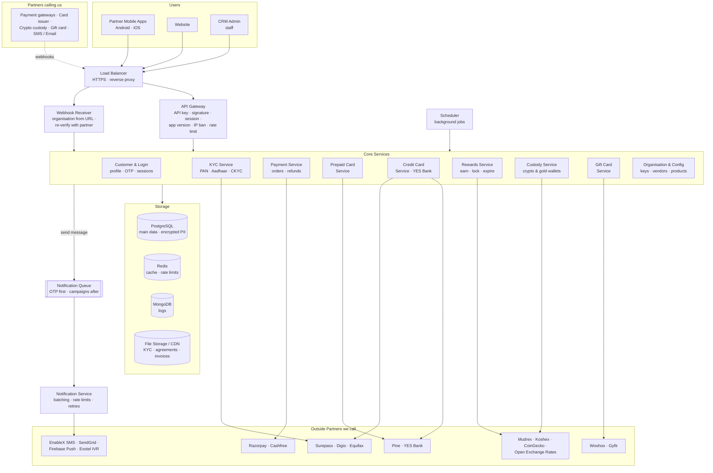
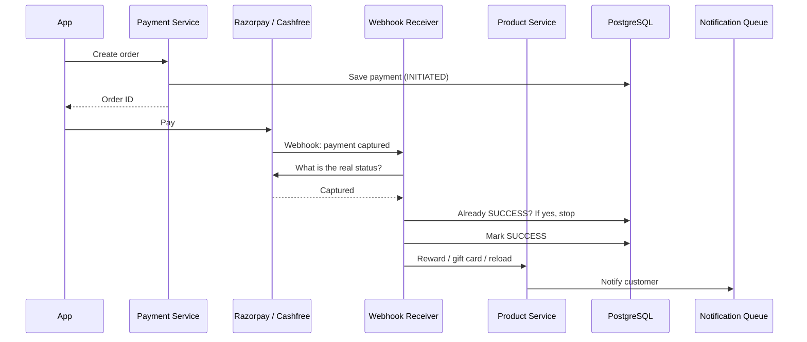

# ANQ — System Design

ANQ is a white-label fintech and rewards platform. Partner companies (called **Organisations**, e.g. `ANQFIN`) launch their own app on top of ANQ. Their customers sign up with a mobile OTP, complete KYC, pay a joining fee, get a **prepaid card** or apply for a **YES Bank credit card**, buy **gift cards**, and earn **rewards in crypto or gold** that they can hold and withdraw from a custody wallet. Staff manage everything from an internal CRM.

---

## 1. Functional Requirements

- **Multi-organisation (multi-tenant)** – One platform serves many partner organisations. Each has its own API keys, products, vendors, limits, and settings.
- **Login** – Customers log in with mobile number + SMS OTP. Staff (CRM users) log in with username + password. Too many wrong OTPs temporarily bans the user.
- **App control** – Block old app versions (force update), disable a platform (Android / iOS / Web), ban IP addresses, bind a session to one device.
- **Customer onboarding** – Profile, address, nominee, bank account (verified by a ₹1 "penny drop"), consents, agreements, referral codes.
- **KYC** – PAN / Aadhaar checks, Central KYC (CKYC), minimum KYC, selfie, document upload.
- **Payments** – Pay joining fees, gift cards, card reloads, and card reissue through Razorpay or Cashfree. Supports discounts, taxes, charges, refunds, and auto-refunds.
- **Prepaid card** – Issue digital and physical cards, track delivery, reload, freeze, reissue, set spending limits, show transactions and offers.
- **Credit card (YES Bank)** – Step-by-step application: details → PAN & duplicate check → credit bureau → Aadhaar eKYC → video KYC → send to bank → track status.
- **Credit report** – Fetch the customer's credit report from Equifax.
- **Gift cards** – Browse the catalogue, buy, and receive gift cards from Woohoo or Gyftr.
- **Rewards** – Earn rewards on joining fees, referrals, gift card purchases, and card spends. Rewards are locked for a period, then unlocked, and expire if unused. The customer picks the reward currency (a crypto coin or gold).
- **Custody (crypto & gold wallets)** – Hold, deposit, buy, sell, and withdraw crypto (Mudrex) and gold (Koshex), with compliance checks.
- **Live prices** – Crypto, gold, and forex exchange rates.
- **Communication** – SMS, email, push notifications, and IVR calls from templates; marketing campaigns to customer segments.
- **Support** – FAQs, announcements, contact-us, customer conversations.
- **CRM (internal admin)** – Search customers; view KYC, payments, cards, rewards, custody; manual corrections; reports.

## 2. Non-Functional Requirements

- **Correct money movement** – A payment, reload, reward, or withdrawal is never lost or applied twice.
- **Security & compliance** – Personal data (mobile, email, PAN, Aadhaar, bank details) encrypted at rest; every request signed; full audit logs.
- **Tenant isolation** – One organisation can never see another organisation's data.
- **High availability** – **99.9%** uptime; webhooks from partners must always be accepted.
- **Low latency** – Most API calls in **< 500 ms** (database queries slower than 500 ms are flagged).
- **Resilience to partners** – A slow or failing vendor (bank, card issuer, gift card vendor) must not bring the app down. Failed work is retried.
- **Vendor flexibility** – Swap a vendor (e.g. Razorpay ↔ Cashfree) per organisation through configuration, without code changes.
- **Observability** – Every request, vendor call, and background job is logged with timing and a request ID.

## 3. Key Challenges

### 3.1 Many partners, one platform

Each organisation has different products, vendors, limits, and settings.
**Solution:** Every request carries an **API key** that identifies the organisation. Its configuration is loaded and attached to the request. Every database row carries an `OrganisationCode`, and every query filters by it.

### 3.2 Tampered or forged requests

Mobile apps talk to the backend over the public internet.
**Solution:** Every request is **signed** (HMAC-SHA512 over method + URL + nonce + session token) with the organisation's secret. The server rejects a wrong signature and signs its own response, so the app can trust the reply.

### 3.3 Duplicate or out-of-order payment webhooks

Razorpay / Cashfree may send "payment captured" more than once, or late.
**Solution:** The webhook is treated only as a **hint**. The server **asks the payment provider for the real status** of the order. If the order is already `SUCCESS` or `REFUND`, it replies "accepted" and does nothing more (idempotency).

### 3.4 One payment triggers several actions

A paid joining fee must create reward accounts and give referral rewards; a paid gift card must place an order with the vendor; a paid reload must load the card.
**Solution:** A single **payment status update** step routes each success to the right product (joining fee → Rewards, gift card → Gift Card service, card reload → Prepaid Card service). Failed vendor orders are **retried by a background job every 30 minutes**.

### 3.5 Long, multi-step partner journeys

The YES Bank credit card journey touches PAN, bureau, Aadhaar, video KYC, and bank systems — any step can fail.
**Solution:** The application is a **stage machine**. Each stage is saved, so the customer can resume. Background jobs push ready applications to the bank, fetch acknowledgements, and expire stale applications nightly.

### 3.6 Protecting personal data

**Solution:** Sensitive columns are marked `ENCRYPT` (reversible, e.g. mobile, email) or `HASH` (one-way) in the data model, and the database layer handles this automatically. Searchable copies live in a separate **PIIVault** area of the database.

### 3.7 Reward and custody balances must always match

Rewards in crypto/gold must be backed by real assets held with Mudrex / Koshex.
**Solution:** Company-level pool accounts (Treasury, Purchase pool, Reward pool, Withheld, Fees). Nightly **reconciliation jobs** compare our ledger with the vendor's balance and alert on any mismatch.

### 3.8 Background jobs running twice

If several servers each run the timers, a job (e.g. "expire rewards") could run twice.
**Solution:** Timers run on **one dedicated Scheduler** instance only. Each run is recorded in `CronLogs` with timing and errors.

### 3.9 Campaign and OTP message bursts

A campaign may target 500K customers; OTPs must still go out instantly.
**Solution:** Messages go through a **Notification Queue** with two priorities — OTP / transactional first, campaigns after. Workers send in batches (500 devices per push call) and stay within each provider's rate limit.

## 4. Capacity Estimation

Working assumptions — replace with real analytics.

| Item                            | Estimate                                                                         |
| ------------------------------- | -------------------------------------------------------------------------------- |
| Organisations                   | 5–20 partners                                                                    |
| Registered / daily active users | 500K / 50K                                                                       |
| API requests                    | 50K users × 40 = 2M/day ≈ 25/sec average, **~200/sec peak** (salary day, offers) |
| Card transaction webhooks       | ~100K/day ≈ 1–2/sec, bursts of ~50/sec                                           |
| Payments                        | ~20K/day (joining fees, reloads, gift cards)                                     |
| SMS / email / push              | OTPs ~100K/day; one campaign up to 500K messages = 1,000 push batches            |
| Database growth                 | ~100K transactions × 2 KB ≈ 200 MB/day (~70 GB/year)                             |
| Logs                            | ~2M access logs/day ≈ 4 GB/day, kept 90 days                                     |
| Files                           | KYC images, agreements, invoices, card application PDFs — ~5 GB/month            |

## 5. High-Level Architecture



**How to read it:** Users and partners both come in through the **Load Balancer**. Users go through the **API Gateway** (the security guard). Partners go through the **Webhook Receiver** (a separate door with its own checks). Both reach the same **Core Services**, which keep data in **Storage** and talk to **Outside Partners**. The **Scheduler** wakes services up on a timer. All messages to customers go through one **Notification Queue**.

### 5.1 Flow — A customer logs in

1. The app sends the mobile number. **Customer & Login** creates a one-time code and queues an SMS.
2. The **Notification Service** sends it through EnableX.
3. The app sends the code back. If it matches, a **session** is created and its token returned.
4. Every later request carries the API key, session token, device hash, and signature. The session ends after the organisation's inactivity timeout or if the device changes.
5. Too many wrong codes → the customer is **OTP-banned**; a job lifts the ban after the cool-off (every 10 min).

### 5.2 Flow — A customer pays (joining fee, gift card, or card reload)

1. The app asks the **Payment Service** to create an order. Discounts, taxes, and charges are applied; the record is saved as `INITIATED`.
2. The customer pays on Razorpay / Cashfree.
3. The gateway calls our **webhook** ("payment captured").
4. The Webhook Receiver checks the organisation is active, then the Payment Service **fetches the true status from the gateway**. Already `SUCCESS`? Stop here.
5. Status becomes `SUCCESS` and the matching product is triggered:
   - **Joining fee** → create reward accounts, give joining + referral rewards.
   - **Gift card** → place the order with Woohoo / Gyftr.
   - **Card reload** → load money onto the prepaid card through Pine.
6. A confirmation message is queued for the customer.



### 5.3 Flow — Customer spends with the prepaid card

1. The customer swipes the card at a shop.
2. **Pine** (card issuer) sends a **transaction webhook**.
3. The **Prepaid Card Service** saves the transaction and asks the **Rewards Service** to allocate a reward based on the organisation's reward rules.
4. The reward is credited in the customer's chosen currency (e.g. Bitcoin or gold) as **locked**. A nightly job unlocks it after the lock-in period; another expires unused rewards.
5. Once unlocked, the customer can move it to their **Custody** wallet and withdraw.

### 5.4 Flow — Customer applies for a YES Bank credit card

1. Fill personal, professional, and address details (saved stage by stage).
2. PAN check and **duplicate check** with the bank.
3. Credit **bureau** / eligibility check.
4. **Aadhaar eKYC** with OTP.
5. Schedule and complete **video KYC**.
6. A background job sends the application and generated documents to the bank's loan system, then fetches acknowledgements and card status in bulk.

### 5.5 Flow — Crypto deposit and withdrawal (Custody)

- **Deposit:** Mudrex sends a webhook. If the coin is supported and passes the compliance check and the customer's KYC is done, funds move to the **Treasury** account and the balance is added. Otherwise they go to **Withheld**. Unknown coins are stored for audit only.
- **Withdraw:** The request is saved as `PENDING APPROVAL`. The customer confirms with SMS / email OTP. The balance is deducted, funds move from Treasury to the customer's chosen chain, and a webhook confirms completion.

### 5.6 Background jobs (Scheduler)

| Frequency    | Jobs                                                                                                                                                                           |
| ------------ | ------------------------------------------------------------------------------------------------------------------------------------------------------------------------------ |
| Every 3 min  | Send scheduled marketing campaigns                                                                                                                                             |
| Every 5 min  | Refresh exchange rates (crypto, gold, forex)                                                                                                                                   |
| Every 10 min | Lift expired OTP bans                                                                                                                                                          |
| Every 15 min | Remind customers who dropped off during payment                                                                                                                                |
| Every 30 min | Payment report; retry failed gift card orders; update pending corporate card reloads                                                                                           |
| Hourly       | Update corporate balances; notify customers whose rewards became available                                                                                                     |
| Nightly      | Expire / unlock rewards; sync gift card catalogue; gold reconciliation; custody balance check; disable expired offers and announcements; expire stale credit card applications |
| Daily 14:00  | IVR reminder calls                                                                                                                                                             |

## 6. Core Components

| Component                 | What it does (plain English)                                                       | Implemented in                                                       |
| ------------------------- | ---------------------------------------------------------------------------------- | -------------------------------------------------------------------- |
| **Load Balancer**         | Single front door; HTTPS; spreads traffic across servers                           | Reverse proxy in front of the containers (forwards real IP / host)   |
| **API Gateway**           | Checks API key, signature, session, app version, IP ban; picks the organisation    | `middlewares/authHandler` + `requestId`, `timing`, `errorHandler`    |
| **Webhook Receiver**      | Separate door for partners; organisation taken from the URL                        | `webhook.ts` + `webhooks/` (payments, ppc, custody, giftcard, comms) |
| **Customer & Login**      | Sign-up, OTP, sessions, profile, address, nominee, bank accounts, referrals        | `modules/Customer`, `modules/Session`                                |
| **KYC Service**           | PAN / Aadhaar / CKYC / min-KYC checks and documents                                | `modules/KYC`, `endpoints/prepaidCard/ckyc`, `minKYC`                |
| **Payment Service**       | Orders, discounts, taxes, status checks, refunds, routing success to products      | `modules/Payment`                                                    |
| **Prepaid Card Service**  | Issue, deliver, reload, freeze, reissue, limits, transactions, offers              | `modules/PrePaidCard` (Pine)                                         |
| **Credit Card Service**   | YES Bank application stages, bureau, eKYC, video KYC, bank hand-off                | `modules/CreditCard` (YBL, Equifax)                                  |
| **Rewards Service**       | Reward schemes and rules, allocation, lock / unlock / expire, reward accounts      | `modules/Rewards`                                                    |
| **Custody Service**       | Crypto & gold accounts, wallets, deposits, buy / sell, withdrawals, reconciliation | `modules/Custody` (Mudrex, Koshex)                                   |
| **Gift Card Service**     | Catalogue, guardrails (limits), orders, vendor sync                                | `modules/GiftCard` (Woohoo, Gyftr)                                   |
| **Organisation & Config** | Organisations, API keys, vendors per organisation, products, currencies, CRM users | `modules/Organisation`, `modules/Master`                             |
| **Notification Service**  | SMS / email / push / IVR from templates; campaigns; delivery status                | `modules/Communication` (EnableX, SendGrid, Firebase, Exotel)        |
| **Scheduler**             | Runs timed jobs; logs each run                                                     | `services.ts` (`Deno.cron`)                                          |
| **Vendor connectors**     | One small client per partner with typed requests, errors, and logging              | `vendors` submodule (`vendors-main`)                                 |
| **Shared libraries**      | Database layer, validation, config, OTP, logging, endpoint framework               | `TundraLibs` (`norm`, `guardian`, `config`, `endpoint`, `otp` …)     |

**Vendor routing:** Each organisation has rows in `OrganisationVendors` saying which partner serves which job (`PAYMENTPROCESSOR`, `SMSOUTBOUND`, `PREPAIDCARDS`, `GIFTCARD`, `CRYPTO_CUSTODY`, `GOLD_CUSTODY`, …). Services ask "who is my payment processor?" at runtime, so switching vendors is a configuration change.

## 7. Database Design

### 7.1 PostgreSQL (main database)

One database, split into logical areas (schemas). Every table has `OrganisationCode`. 🔒 = encrypted column.

```
Organisation   Organisations   { Code (PK), Name, Configuration (JSON: sessions, modules, limits), Active }
               OrganisationKeys{ Id = API key, OrganisationCode, Secret 🔒, ExpiryDate, Active }
               OrganisationVendors { VendorId, OrganisationCode, Type, Config 🔒, SessionConfig, Active }
               OrganisationUsers   { Id, OrganisationCode, UserName, Email 🔒, Role, Active }
               AppInfo / Platforms { Platform, Version, Active, Url }     IPRestrictions { IPAddress, BanDate, UnBanDate }

Customer       Customers       { CustomerId (UUID), CustId, OrganisationCode, Mobile 🔒, Email 🔒,
                                 Name, DOB, Segment, ReferralCode, FCMToken, RewardCurrency, JoinDate }
               CustomerStatus  { CustomerId, PlatformKYCStatus, PlatformEnabled, OTPBan, OTPUnBanTime,
                                 per-product status (PrePaidCard, GiftCard, Custody, Rewards, CreditCardYBL ...),
                                 IsJoiningFeePaid, DND, VIP }
               CustomerSecrets { CustId, Type (AUTHENTICATION...), Channel, OTP 🔒, Expiry }
               BankAccounts 🔒, CustomerAddress 🔒, CustomerNominee 🔒, Consents, Agreements, DeviceInfo

PIIVault       CustomerSearch, KYCSearch, BankAccountsSearch   (searchable copies for lookups)
               KYCDocuments    { CustId, DocumentType, Number 🔒, Status, ExpiryDate }

Session        Sessions        { Id = token, CustId | UserId, Role, DeviceHash, LastActivity, Active, LogOutReason }

Payments       Transactions    { Id, OrderId (UNIQUE), CustId, PaymentFor (JOINING-FEES | GIFT-CARD |
                                 CARD-RELOAD | CARD-REISSUANCE ...), Amount, Status (INITIATED | PROCESSING |
                                 SUCCESS | FAILED | CANCELLED | REFUND | AUTO_REFUNDED), VendorId, AdditionalData }
               Items, Charges, Taxes, DiscountCodes, UsedVouchers, StatusReport

PrePaidCard    CardDetails 🔒, CardRequests, CardTransactions { RRN, Amount, Merchant, Type }, Reload,
               DeliveryStatus, CardTypes, CardConfigs, DtcOffers, ExclusiveOffers

CreditCard     Applications { CustId, Stage, Status, FormNo }, ApplicationInfo 🔒, PersonalDetails,
               ProfessionalDetails, CreditReport 🔒, Contacts, Pincode, YBLCompanies

Reward         RewardSchemes, RewardRules { SchemeId, RefId, Min, Max, Bucket }, RewardAccounts,
               RewardAllocations { CustId, Type, ReferenceId, Amount, Currency, Status (LOCKED |
                                   UNLOCKED | TRANSFERRED | EXPIRED | REVERSED | CANCELLED), ExpiryDate },
               AllocationLogs, Mints, CustomerPreferences

Custody        CustodyAccounts { CustId | company pool, CurrencyId, ReferenceId, Balance, WithheldBalance },
               Wallets, InternalTransactions, ExternalTransactions, InvalidTransactions,
               ManualTransactions, PurchaseAssetsHistory

GiftCard       GiftCardProducts, VendorProducts, Orders { CustId, SKU, Amount, PaymentId, Status }, GiftCards 🔒

Others         ExchangeRates / CurrentRates, Campaigns, CommunicationTemplates, CommunicationLogs,
               FAQ, Announcements, CustomerConversations, Masters (country, state, pincode, bank codes ...)
```

### 7.2 Other stores

- **MongoDB (logs)** – `AccessLogs` (every API call), `IntegrationLogs` (every vendor call), `CronLogs` (every job run), `DBLogs`, `LogDetails`.
- **File storage / CDN** – Uploads, KYC images, agreements, invoices, reconciliation files, credit card application PDFs (max 10 MB per upload).
- **Redis** – Cache, rate-limit counters, and the Notification Queue (expiry times in 7.3).

### 7.3 Redis cache expiry (TTL)

Each entry expires on its own and is also cleared early when the underlying data changes (admin edit, logout, new price).

| Cached item                                     | TTL                                    | Why                                                      |
| ----------------------------------------------- | -------------------------------------- | -------------------------------------------------------- |
| Organisation config, API keys, vendor settings  | **5 min**                              | Read on every request; rarely changes; admin edit clears |
| App version / platform status                   | **5 min**                              | Force-update must take effect quickly                    |
| Session lookup                                  | **Organisation's inactivity timeout**  | Session must not outlive its timeout; logout clears it   |
| Live prices and exchange rates                  | **5 min**                              | Matches the 5-minute refresh job                         |
| Gift card catalogue                             | **24 hours**                           | Synced nightly from vendors                              |
| Master data (pincodes, bank codes, professions) | **24 hours**                           | Almost never changes                                     |
| FAQs, announcements, card types, offers         | **1 hour**                             | Changes slowly; expiry jobs clear early                  |
| Customer reward / custody balances              | **30 s**                               | Money values must be near real time                      |
| OTP attempt counters                            | **10 min**                             | Matches the OTP-unban window                             |
| Rate-limit counters                             | **1 min**                              | Per-minute limit window                                  |
| Processed webhook IDs                           | **48 hours**                           | Fast duplicate check; database status is the final guard |
| Queue jobs                                      | Done: **24 hours**, failed: **7 days** | Enough time to debug failures                            |

## 8. API Design (examples)

Every API call sends these headers: `x-api-key`, `x-signature`, `x-nounce`, `x-app-platform`, `x-app-version`, `x-app-version-id`, `x-device-hash`, and `authorization: Bearer <session>` after login. Lists use `x-pagination-page` / `x-pagination-limit` and return `x-total-rows`.

```
POST /auth/customer/                               → OTP sent
POST /auth/customer/  { OTPValue }                 → { session token }
POST /customer/                                    → create customer
POST /v2/customer/{CustId}/kyc/process             → run KYC
POST /customer/{CustId}/transaction/               → create payment order
POST /customer/{CustId}/GiftCard/Orders/           → buy gift card
POST /v2/card/{CustId}/digital/issue               → issue prepaid card
POST /card/reload                                  → reload card
POST /creditcard/ybl/{CustId}/stage/dedupe         → credit card stage
GET  /reward/{CustId}/accounts/                    → reward balances
POST /custody/{CustId}/withdraw/crypto             → withdraw crypto

Webhooks (organisation in the URL, status re-verified with the partner):
POST /{Org}/paymentgateway/captured/notifications/     Razorpay
POST /{Org}/cashfree/captured/notifications/           Cashfree
POST /{Org}/ppc/notifications/transaction              Pine card spend
POST /{Org}/custody/token/notifications/transaction    Mudrex deposit / withdrawal
POST /{Org}/giftcard/notifications/orders              Gift card vendor
POST /{Org}/sendgrid/notifications/                    Email delivery status
```

## 9. Scalability Measures

- **Horizontal scaling** – API and Webhook servers are stateless (sessions live in the database / Redis), so more copies can be added behind the load balancer.
- **Separate doors** – API, Webhooks, and Scheduler run as separate processes from the same code, so a webhook burst does not slow the app, and vice versa.
- **Caching** – Organisation config, prices, and master data served from Redis (TTLs in 7.3).
- **Queues absorb spikes** – Campaigns and alerts wait in the Notification Queue instead of blocking requests.
- **Batching** – Push notifications sent in batches; bulk SMS for campaigns; bank hand-offs done in bulk jobs.
- **Database** – Connection pooling, slow-query warnings (> 500 ms), read replica for CRM reports.
- **Single scheduler** – Only one instance runs timers, so jobs are not missed or doubled.

## 10. Security

- HTTPS end to end; **CORS** allows only ANQ web domains.
- **Request signing** – HMAC-SHA512 over method, URL, nonce, and session token; responses signed too.
- **Sessions** – Stored server-side, tied to device hash, expire on inactivity; logout reason recorded.
- **Abuse control** – IP ban list per organisation, OTP ban after repeated failures, old app versions blocked.
- **Encryption at rest** – PII columns encrypted / hashed by the database layer; database connection uses TLS.
- **Webhooks** – Only active organisations accepted; payment status always re-checked with the provider.
- **Secrets** – Database, vendor, and encryption keys come from environment variables / secrets manager — **never in code or images**.
- **Staff access** – CRM endpoints are separate (`…CRM`) and need a staff session with a role.

## 11. Monitoring

- **Logs** – Access, vendor-call, job, and database logs in MongoDB, each with a request ID and response time.
- **Errors** – Sentry for crashes; GitLab alerts for operational issues; email alerts for gift card failures and low custody balance.
- **Health check** – `/status` reports web and database health; the container restarts on failure.
- **Track** – Payment success rate, webhook failures, vendor error rate and latency, OTP delivery rate, queue length, reconciliation mismatches, job failures.

## 12. Trade-offs & Alternatives

| Choice                               | Why                                                                   | Alternative                                                                 |
| ------------------------------------ | --------------------------------------------------------------------- | --------------------------------------------------------------------------- |
| **PostgreSQL**                       | Money, cards, and KYC need strict, consistent records                 | MongoDB is more flexible but weaker for financial ledgers                   |
| **MongoDB for logs**                 | High write volume, flexible shape, kept apart from business data      | Elasticsearch / Loki for better search, at higher cost                      |
| **One codebase, three processes**    | Simple to build and deploy; API / Webhooks / Scheduler still isolated | Full microservices per product — more scaling freedom, much more complexity |
| **Re-verify webhooks with provider** | Works even if a webhook is forged or out of order                     | Signature-only check is faster but trusts the payload                       |
| **Vendors chosen by configuration**  | Each partner can use different vendors; easy to switch                | Hard-coded vendors are simpler but lock everyone in                         |
| **Redis queue for notifications**    | Redis already needed for cache; message volume is moderate            | Kafka gives replay and higher throughput, more than this scale needs        |
| **Polling jobs for pending states**  | Some partners (bank, gift card vendors) do not push every update      | Webhooks only — fewer calls, but missed updates would never recover         |

## 13. Current Code vs This Design

The design above describes the target. These items differ in today's code (`42-services-dev`):

| Area               | Today                                                                   | In this design                                        |
| ------------------ | ----------------------------------------------------------------------- | ----------------------------------------------------- |
| Cache              | No Redis; organisation config and session read from PostgreSQL per call | Redis cache with TTLs (7.3)                           |
| Notifications      | SMS / email / push sent directly inside the request                     | Notification Queue with priorities, batching, retries |
| Rate limiting      | Throttle middleware exists in TundraLibs but is not used                | Per-organisation / per-IP limits at the gateway       |
| Replay protection  | Nonce is signed but not checked for reuse                               | Reject a nonce seen within the last few minutes       |
| Webhook signatures | Payment webhooks re-verify status but do not check provider signatures  | Check signature **and** re-verify status              |
| Scheduler          | `Deno.cron` runs inside whichever process starts `services.ts`          | Exactly one Scheduler instance                        |
| Secrets            | An encryption key is hard-coded in the `Dockerfile`                     | Load from secrets manager; rotate the exposed key     |
| Jobs per tenant    | Jobs run only for organisation `ANQFIN`                                 | Loop over all active organisations                    |
| SMS status         | Marked `DELIVERED` on send (comment notes webhook pending)              | `SENT` on send, `DELIVERED` from the EnableX webhook  |
