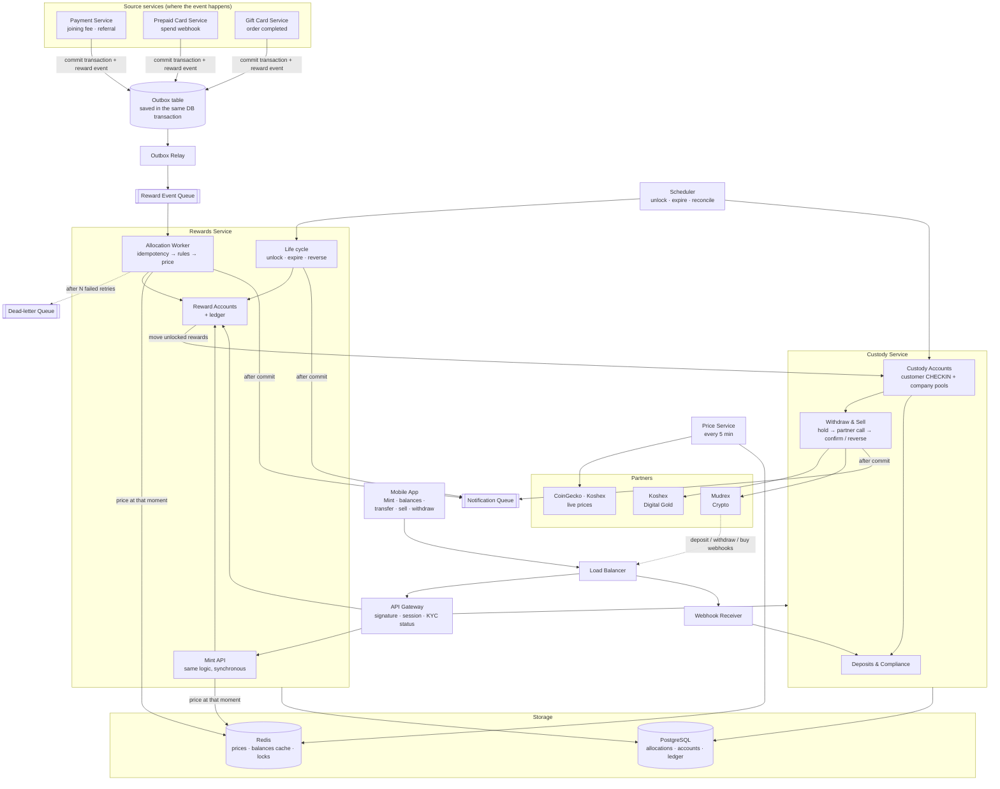
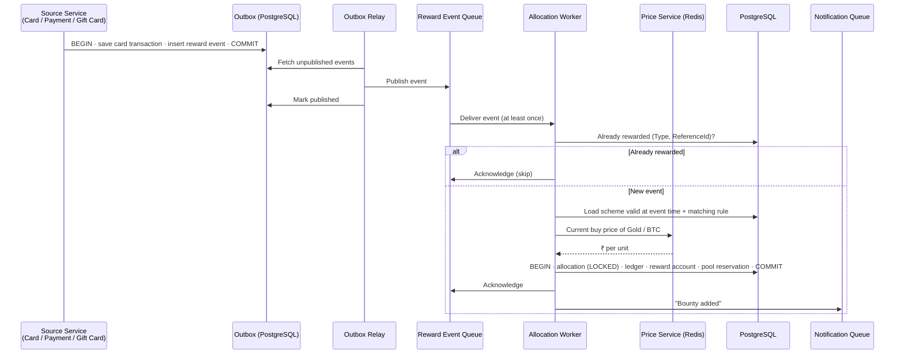
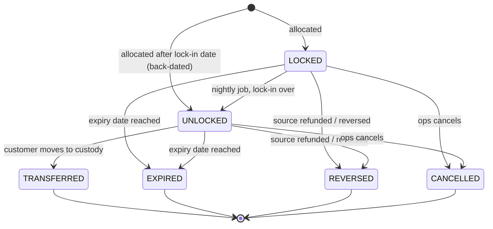
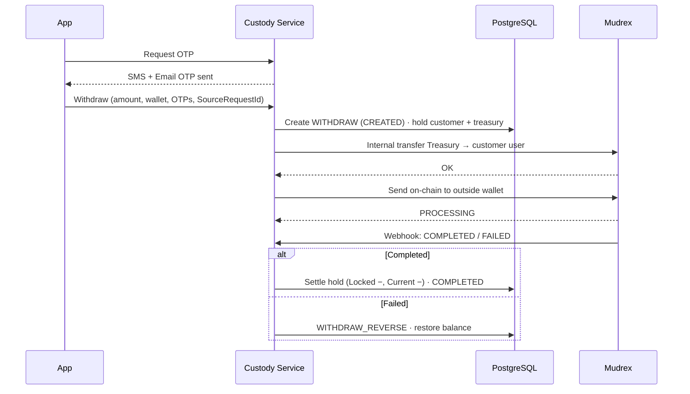
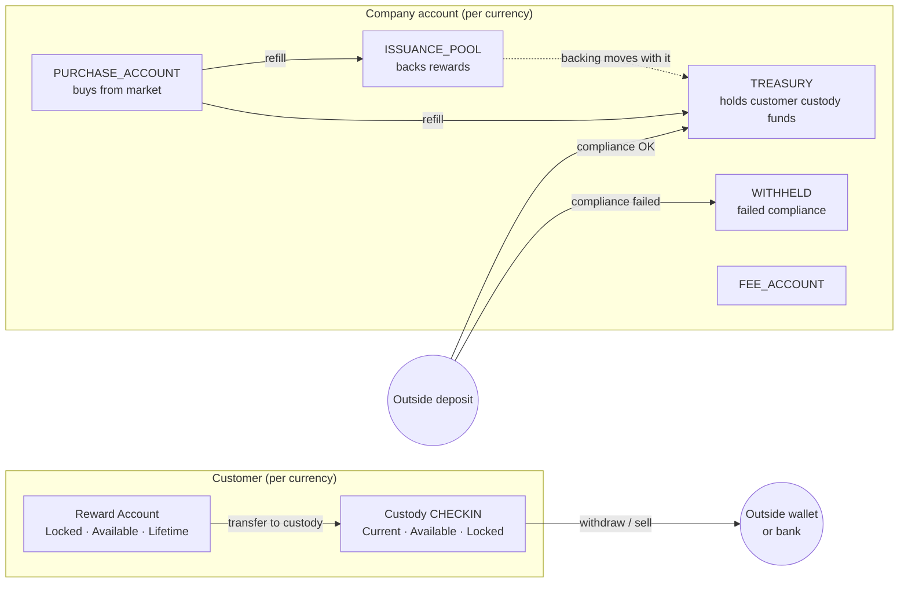

# ANQ Rewards & Custody — System Design

This document zooms into two parts of ANQ (see `ANQ_SYSTEM_DESIGN.md` for the whole platform):

- **Rewards** – Customers earn rewards (called **"bounties"** in the app) when they pay a joining fee, refer a friend, buy a gift card, spend on their prepaid card, or tap the daily **"Mint"** button. The reward value is decided in rupees and then converted into **Digital Gold** or **Bitcoin** at that moment's price.
- **Custody** – The wallet that actually holds the customer's gold and crypto. Real assets sit with partners **Koshex** (gold) and **Mudrex** (crypto). From custody, customers can **sell gold to their bank account**, **withdraw crypto to an outside wallet**, or **deposit crypto**.

> **Simple picture:** Rewards is the _piggy bank with a time lock_. Custody is the _bank vault_. When the time lock opens, the customer moves coins from the piggy bank into the vault, and from the vault they can cash out.

---

## Real-world Engineering Impact

> **Fill this in with actual production figures only.** Every number in Section 4 is a **design assumption** used to size the system, not measured traffic. Rows marked _[fill in]_ need your own facts; the other details come from the codebase.

| Item                  | What to include                          | Details                                                                                                                                                                                                                                                                                                                              |
| --------------------- | ---------------------------------------- | ------------------------------------------------------------------------------------------------------------------------------------------------------------------------------------------------------------------------------------------------------------------------------------------------------------------------------------ |
| **My role**           | Your ownership as a founding engineer    | _[fill in: title, team size, what you owned end to end]_                                                                                                                                                                                                                                                                             |
| **Scope**             | Which parts you designed and implemented | _[fill in: list only what you personally built]_. Areas covered by this document: rules engine and allocation, reward life-cycle jobs, daily Mint, reward → custody transfer, crypto withdrawal, gold sell with automatic reversal, deposits and compliance, reconciliation jobs, Koshex / Mudrex connectors.                        |
| **Technology**        | Languages, databases, infrastructure     | **Deno + TypeScript** (Oak web framework, in-house TundraLibs), **PostgreSQL** (main data, outbox, ledger, encrypted personal-data columns), **Redis** (prices, balance cache, locks, Reward Event Queue), **MongoDB** (request, partner-call and job logs), `Deno.cron` scheduler, Docker.                                          |
| **External systems**  | Koshex and Mudrex                        | **Koshex** – digital gold: customer accounts, buy, sell to bank, transfers, live price, daily recon CSV. **Mudrex** – crypto: users, deposit wallets, internal transfers, on-chain withdrawals, buy orders, compliance screening, webhooks. Also CoinGecko (prices) and the event sources Pine, Razorpay / Cashfree, Woohoo / Gyftr. |
| **Scale**             | Actual customer and transaction volumes  | _[fill in: registered customers, monthly active customers, reward allocations per day, custody transactions per day — production numbers]_                                                                                                                                                                                           |
| **Business impact**   | Actual reward and custody value          | _[fill in: ₹ rewards issued per day / month, custody assets held, gold sold and crypto withdrawn per month]_                                                                                                                                                                                                                         |
| **Biggest challenge** | A real engineering issue you solved      | _[fill in: problem → what you did → measurable result]_. Candidates visible in the code (use only if you built them): automatic `SELL_REVERSE` when a Koshex sale fails after the transfer; holding funds before a Mudrex withdrawal; request-ID idempotency for sells and withdrawals; compliance-gated deposits.                   |

---

## 1. Functional Requirements

### Rewards

- **Earn on events** – Joining fee paid, referral (the person whose code was used gets the reward), gift card purchase, prepaid card spend, daily Mint.
- **Configurable rules per organisation** – Each reward type has a **scheme** (lock-in days, expiry days, partner, validity dates) and **rules** that decide the amount:
  - **FIXED** – A flat amount (e.g. ₹200 for joining). With a Min and Max, a random amount in that range (e.g. Mint gives ₹1–₹7).
  - **PERCENTAGE** – A percentage of the purchase (e.g. 5% on a specific gift card).
  - **BUCKET-MULTIPLIER** – A fixed amount for every block of spend (e.g. ₹1.50 for every ₹150 spent on the card).
  - Rules can be specific to a gift card SKU, a merchant category (MCC), or a beneficiary, with a default fallback.
- **Partner-specific schemes** – If the customer joined via a partner's referral code, that partner's scheme is used; otherwise the default scheme.
- **Choose reward currency** – Customer chooses Gold or Bitcoin (per product: Prepaid Card, Credit Card, Gift Card, Onboarding). Default is Digital Gold.
- **Lock, unlock, expire** – New rewards are **LOCKED** (30 days by default), then **UNLOCKED**, and **EXPIRE** if not moved within 90 days.
- **Reverse / cancel** – Undo a reward when the underlying payment or card transaction is reversed or refunded.
- **Daily Mint** – Once every 24 hours the customer can tap to "mint" a small random bounty; an hourly job reminds customers when Mint is available again.
- **Balances** – Show locked, available, total, and lifetime rewards, in both the coin and in rupees.
- **Reprocessing (CRM)** – Find rewards that are missing or wrong for a customer and fix them.

### Custody

- **Accounts** – Each customer gets a **CHECKIN** account per supported currency (Gold, BTC, ETH, SOL, USDT, USDC, BUSD) at the partner.
- **Company pool accounts** – TREASURY, WITHHELD, ISSUANCE_POOL, PURCHASE_ACCOUNT, FEE_ACCOUNT, owned by the organisation's company account.
- **Move rewards to custody** – Transfer all unlocked rewards of a currency into the custody account.
- **Sell gold** – Sell gold for rupees, paid to the customer's verified bank account.
- **Withdraw crypto** – Send crypto to an outside wallet on a chosen blockchain network, after SMS + email OTP.
- **Deposit crypto** – Get a deposit address; incoming funds are credited only after a compliance check.
- **Wallet safety** – Validate addresses, keep a whitelist, block wallets that fail compliance.
- **Company asset purchase** – Ops buys gold / crypto into the company pools to back customer balances.
- **Reconciliation** – Daily reports to partners, daily balance comparison, hourly company balance check with alerts.

## 2. Non-Functional Requirements

- **Money is exact** – No reward or coin is created, lost, or counted twice. Decimal maths with per-currency precision (no floating-point rounding).
- **Every reward is backed** – The total owed to customers never exceeds what the company actually holds with Koshex / Mudrex.
- **Auditable** – Every balance change can be traced to an event (payment, card spend, transfer, sale, withdrawal).
- **Safe withdrawals** – OTP on two channels, whitelisted wallets, compliance screening, one withdrawal per 24 hours.
- **Resilient to partner failures** – If Koshex / Mudrex fails halfway, the customer's balance is restored automatically.
- **Freshness** – Prices are refreshed every 5 minutes; gold sell quotes are never older than 3 minutes.
- **Latency** – Balance screens < 300 ms; reward allocation does not slow the payment or card webhook that triggered it.

## 3. Key Challenges

### 3.1 The same event giving two rewards

Payment and card webhooks can arrive twice, and a customer can double-tap Mint.
**Solution:** Every reward is tied to its source with `(Type, ReferenceId)` — e.g. `(PREPAID-CARDS, card transaction id)`. A **unique database constraint** on that pair means the second attempt is simply rejected.

### 3.2 Two updates to the same balance at once

A reward credit and a transfer-to-custody can hit the same account in the same second.
**Solution:** Each balance change runs in **one database transaction** that locks the account row, writes **ledger entries** (section 7.4), and updates the balance. Either everything is saved or nothing is.

### 3.3 Rewards must be backed by real gold / crypto

A reward of 0.002 g gold is a promise; real gold must exist at Koshex.
**Solution:** The company keeps an **ISSUANCE_POOL**. Allocating a reward **reserves** that amount from the pool; moving it to custody **transfers** it to TREASURY; expiry **returns** it to the pool. If the pool runs low, ops is alerted to buy more (section 5.8).

### 3.4 Partner fails in the middle of a withdrawal or sale

Withdrawing crypto needs two Mudrex calls (internal transfer, then on-chain send). Selling gold needs two Koshex calls (transfer, then sell).
**Solution:** Hold the money first (move it to **LockedBalance**), then call the partner. On failure, run the **reverse step** (e.g. `SELL_REVERSE`) and release the hold. If even the reverse fails, mark `SELL_GOLD_AND_REVERSE_FAILED` and raise an ops alert for manual fixing.

### 3.5 Customer retries the same withdrawal

**Solution:** The app sends a `SourceRequestId`, which becomes the transaction's ID. A second request with the same ID fails instead of creating a second withdrawal (idempotency).

### 3.6 Suspicious incoming crypto

**Solution:** Deposits are saved with compliance status `PENDING`. Only on `SUCCESS` from Mudrex's screening is the customer credited. On `FAILURE`, the funds go to **WITHHELD** and the source wallet is blocked. Deposits in unsupported coins go to an **InvalidTransactions** table for audit.

### 3.7 Price changes between "earn" and "cash out"

**Solution:** At allocation, the **buy price** and its price-record ID are stored with the reward, so the coin amount never changes later. Rupee values on screen use the latest price.

### 3.8 Nightly jobs over many rows

Unlock and expiry touch every reward whose date has passed.
**Solution:** Process in **batches** (e.g. 1,000 rows), each batch in its own transaction, and make the job **safe to re-run** (it only picks rows still in the old status).

### 3.9 A reward event lost between "payment saved" and "reward created"

If the payment or card transaction is saved but the process crashes before Rewards is called, the customer silently gets nothing. Calling Rewards inside the webhook also makes the partner wait for rule evaluation and the price lookup.
**Solution (Outbox pattern):** The source service writes a **reward event into an outbox table in the same database transaction** as the payment / card transaction. An **Outbox Relay** publishes those rows to the **Reward Event Queue**, and an **Allocation Worker** processes them. Either both the transaction and its event are saved, or neither is — the event cannot be lost. Delivery is _at least once_, so the worker relies on the `(Type, ReferenceId)` unique key (3.1) to ignore repeats.

### 3.10 Events arriving out of order

A refund's "reverse reward" event can reach the worker before the original allocation is finished.
**Solution:** If the allocation to reverse does not exist yet, the worker retries later with backoff. After N attempts the event goes to a **dead-letter queue** and ops is alerted.

## 4. Capacity Estimation

**Design assumptions — not production figures.** These numbers were chosen to size the design; they were not measured. Real production figures belong in _Real-world Engineering Impact_ above.

| Item                            | Estimate                                                                                                      |
| ------------------------------- | ------------------------------------------------------------------------------------------------------------- |
| Customers with reward wallet    | 500K registered, 50K daily active                                                                             |
| Reward allocations              | Card spends ~100K + Mints ~30K + gift cards / joining / referral ~5K ≈ **135K/day** ≈ 2/sec, **peak ~30/sec** |
| Nightly unlock / expiry         | ~135K rows each night (rewards from 30 / 90 days ago) → ~135 batches of 1,000                                 |
| Transfers to custody            | ~10K/day                                                                                                      |
| Gold sells / crypto withdrawals | ~3K / ~1K per day; each makes 2 partner calls                                                                 |
| Crypto deposits                 | ~500/day (webhooks + compliance checks)                                                                       |
| Storage                         | Allocations 135K × 0.5 KB ≈ 70 MB/day (~25 GB/year); custody transactions ~5 MB/day                           |
| Price refresh                   | 7 currencies every 5 min = ~2K price rows/day                                                                 |

## 5. High-Level Architecture



**How to read it:** When something reward-worthy happens, the source service saves its own transaction **and** a reward event in one database transaction (the **Outbox**). The **Outbox Relay** moves events onto the **Reward Event Queue**, so the payment or card webhook never waits for Rewards. The **Allocation Worker** checks the event was not already rewarded, picks the rule, converts rupees to gold or Bitcoin, and saves everything in one transaction. **Daily Mint is the one exception:** the customer is waiting on screen for the amount, so the Mint API runs the same allocation logic directly (still one transaction, idempotent on the mint ID). When unlocked, the customer moves rewards into **Custody**, which holds the real assets at **Koshex** and **Mudrex**. The **Scheduler** opens locks, expires old rewards, and checks our numbers against the partners'.

### 5.1 Flow — A customer earns a reward

Example: the customer spends **₹1,500** on the prepaid card, and has chosen **Digital Gold**.

1. **Source transaction committed** – Pine sends the card webhook. In **one database transaction**, the Prepaid Card Service saves the card transaction **and** inserts an outbox row `{ EventId, Type: PREPAID-CARDS, ReferenceId: card transaction id, CustId, OccurredAt }`. It then replies to Pine straight away.
2. **Outbox Relay** – About every second, it picks unpublished outbox rows (`FOR UPDATE SKIP LOCKED`, so two relays never publish the same row), publishes them to the **Reward Event Queue**, and marks them published.
3. **Allocation Worker receives the event** (delivery is at least once).
4. **Idempotency check** – Has `(Type, ReferenceId)` already been rewarded? If yes, acknowledge and stop.
5. **Rule evaluation** – Choose the scheme valid at `OccurredAt`, then the rule, using the precedence in 5.1.1. Here: lock 30 days, expire 90 days; rule BUCKET-MULTIPLIER, ₹1.50 per ₹150 → ₹1,500 ÷ 150 = 10 × ₹1.50 = **₹15**.
6. **Price conversion** – Gold buy price ₹7,500/g → ₹15 ÷ 7,500 = **0.002 g**. Price and price ID are stored with the reward.
7. **One PostgreSQL transaction** – Insert allocation (`LOCKED`, unlock day 30, expiry day 90) + ledger entries + reward account balances + ISSUANCE_POOL reservation. A unique-key clash here means another worker already did it → treat as done.
8. **Acknowledge, then notify** – Only after the commit, a message goes onto the **Notification Queue**: "Ka-ching, bounties added to your bounty wallet!"
9. **On failure** (e.g. no price available) – The event is not acknowledged and is retried with backoff (1 min, 5 min, 30 min …). After N attempts it moves to the **dead-letter queue** with an alert; ops replays it after fixing the cause.



### 5.1.1 How the scheme and rule are chosen

Every lookup is limited to the customer's **organisation**. Exactly **one scheme** and **one rule** are used per reward — rules never stack.

**Step A — pick the scheme** (decides lock-in, expiry, and which rules apply). The reward **Type** is the product (`PREPAID-CARDS`, `GIFT-CARD`, `JOINING-FEES`, `REFERRAL`, `MINT`), so the product is part of the scheme key, not a separate level.

| Priority | Scheme             | Matches when                                                                                                |
| -------- | ------------------ | ----------------------------------------------------------------------------------------------------------- |
| 1        | **Partner scheme** | Same Type, `PartnerCode` = the partner / referral code the customer signed up with, valid on the event date |
| 2        | **Default scheme** | Same Type, no `PartnerCode`, valid on the event date                                                        |
| —        | None found         | No reward; event goes to the dead-letter queue with reason "no scheme"                                      |

**Step B — pick the rule inside that scheme** (decides the amount). Most specific wins.

| Priority | Rule                 | `RefId` holds                                  | Used for                 |
| -------- | -------------------- | ---------------------------------------------- | ------------------------ |
| 1        | **Item rule**        | Gift card SKU, or merchant category code (MCC) | GIFT-CARD, PREPAID-CARDS |
| 2        | **Beneficiary rule** | Card programme / beneficiary ID                | PREPAID-CARDS            |
| 3        | **Default rule**     | Empty                                          | All types                |

`JOINING-FEES`, `REFERRAL` and `MINT` have no item key, so their scheme's single active rule is used.

**Conflicts**

- **One active scheme per (organisation, Type, PartnerCode).** Publishing a new scheme closes the current one at the end of the previous day and starts the new one at 00:00 today, so there is no gap or overlap. A database constraint forbids overlapping date ranges for the same key.
- **One active rule per (scheme, RefId).** Enforced by a partial unique index. If two rules ever match, the **newest** wins and an alert is raised, so the result is always predictable.

**Overlapping validity periods** – Not allowed for the same key (enforced by the constraint above). The scheme is chosen by the event's **`OccurredAt`**, not by processing time, so a card spend made on the 30th but processed after midnight still uses the 30th's scheme. Future schemes can be scheduled ahead by giving them a future `EffectiveFromDate`.

**Scheme revisions and existing rewards**

- Editing a scheme creates a **new row** with `Revision + 1`; the old revision is kept (inactive) as history.
- **Existing rewards never change.** Each allocation stores a snapshot: `SchemeId`, `RuleId`, `BaseAmount`, `RewardAmount`, price, `UnlockDate` and `ExpiryDate`. Shortening lock-in from 30 to 15 days affects only new rewards.
- **Late or replayed events** use the revision that was valid at `OccurredAt`, including inactive revisions.

### 5.2 Reward life cycle



| Status               | Reward account effect                                     | Pool effect                   |
| -------------------- | --------------------------------------------------------- | ----------------------------- |
| LOCKED               | + LockedBalance, + Balance, + LifeTimeBalance             | Reserve from ISSUANCE_POOL    |
| UNLOCKED             | LockedBalance → AvailableBalance                          | —                             |
| TRANSFERRED          | − AvailableBalance, − Balance; + custody CHECKIN balance  | ISSUANCE_POOL → TREASURY      |
| EXPIRED              | − Locked or Available, − Balance                          | Release back to ISSUANCE_POOL |
| REVERSED / CANCELLED | Same as expired; logged in `AllocationLogs` with a remark | Release back to ISSUANCE_POOL |

### 5.3 Flow — Daily Mint

1. App asks "can I mint?" → allowed if no Mint reward in the last 24 hours.
2. Customer taps Mint → a `Mints` row is created and **allocate(MINT, mint id)** runs with the customer's chosen currency.
3. Rule is FIXED with Min ₹1 / Max ₹7 → a random amount in that range, then converted and locked like any reward.
4. An hourly job finds customers whose last Mint was over 24 hours ago and sends "Time to Mint your Bounties today".

### 5.4 Flow — Move rewards to custody

1. Customer taps "Transfer to wallet" for a currency (or "Transfer all").
2. In **one transaction**: take all `UNLOCKED` allocations (oldest first), mark them `TRANSFERRED`, subtract from the reward account's AvailableBalance / Balance, and add the same amount to the custody **CHECKIN** account (AvailableBalance and CurrentBalance).
3. Move the backing amount from **ISSUANCE_POOL** to **TREASURY** in the ledger.
4. If the customer has no custody account yet, it is registered first with Koshex / Mudrex.

### 5.5 Flow — Withdraw crypto to an outside wallet

1. **Checks** – Withdrawals enabled for the organisation, amount > 0, enough AvailableBalance, no other withdrawal in the last 24 hours, daily limit not exceeded (KYC vs non-KYC limit).
2. **OTP** – One code by SMS and one by email; both must match.
3. **Create request** – An external transaction `WITHDRAW / CREATED` with the app's `SourceRequestId` as its ID.
4. **Hold** – Customer CHECKIN: Available − amount, Locked + amount (Current unchanged). Company TREASURY: Locked + amount (earmarked).
5. **Validate wallet** – Address format, network, whitelist status. Fail → undo the hold, mark `FAILED`.
6. **Mudrex step 1** – Internal transfer TREASURY → customer's Mudrex user (up to 3 attempts).
7. **Mudrex step 2** – On-chain withdrawal to the outside address; status becomes `PROCESSING`. A fee (default 0.25) is recorded.
8. **Webhook** – Mudrex reports `COMPLETED` → settle: Locked − amount and Current − amount on both accounts. `FAILED` → `WITHDRAW_REVERSE`: customer Locked − amount, Available + amount; treasury Locked − amount. Compliance failure blocks the destination wallet.
9. **Manual mode** – For special cases a `ManualTransactions` row is created and ops completes it from the CRM.



### 5.6 Flow — Sell gold to bank account

1. Customer enters a rupee amount and picks a verified bank account (penny-drop verified).
2. **Fresh price** – If the stored gold price is older than **3 minutes**, fetch a new one from Koshex. Get a SELL quote → grams.
3. **Minimum check** – Amount must be above the organisation's minimum sell value.
4. **Create request** – External transaction `SELL / CREATED` (ID = `SourceRequestId`), compliance `NOT_APPLICABLE`.
5. **Hold** customer CHECKIN and company TREASURY (same pattern as 5.5).
6. **Koshex step 1** – Transfer grams from TREASURY to the customer's Koshex account.
7. **Koshex step 2** – Sell those grams for INR, paid to the bank account.
8. **Result:**
   - Both succeed → `COMPLETED`, hold released.
   - Sell fails → `SELL_REVERSE` transfer back, balances restored, `FAILED (SELL_GOLD_FAILED)`.
   - Sell **and** reverse fail → `FAILED (SELL_GOLD_AND_REVERSE_FAILED)` + ops alert.
   - Transfer fails → balances restored, `FAILED (GOLD_TRANSFER_FAILED)`.

### 5.7 Flow — Crypto deposit

1. App asks for a deposit address for a coin + network → a DEPOSIT wallet is created at Mudrex (or reused).
2. Customer sends crypto from outside. Mudrex sends a webhook.
3. Unknown coin / address → saved to **InvalidTransactions** (audit only).
4. Known → saved as external transaction with compliance `PENDING`. A compliance check also polls Mudrex for pending results, so a missed webhook does not leave money stuck.
5. Compliance **SUCCESS** → TREASURY + amount, customer CHECKIN Available + Current + amount. (KYC was already checked when the crypto custody account was created.)
6. Compliance **FAILURE** → funds held in **WITHHELD**, source wallet's whitelist flag turned off.
7. The same webhook is idempotent: a repeat with an unchanged status does nothing.

### 5.8 Flow — Company buys assets (refill the pools)

1. Ops uses the CRM to buy gold (Koshex) or crypto (Mudrex) into the company **PURCHASE_ACCOUNT**, paying in INR or USDT.
2. The purchase is logged in **PurchaseAssetsHistory** with wallet balance before and after.
3. Crypto buys are confirmed by a Mudrex `BUY` webhook / status check.
4. Company balances are refreshed from the partners; a daily email lists the previous day's gold purchases.
5. A low **ISSUANCE_POOL** (below N days of expected rewards) raises an alert to trigger this flow.

### 5.9 Background jobs (Rewards & Custody)

Times are UTC (as configured in `Deno.cron`).

| Schedule     | Job                    | What it does                                                                                                      |
| ------------ | ---------------------- | ----------------------------------------------------------------------------------------------------------------- |
| Every 5 min  | ExchangeRates          | Refresh gold / crypto / forex prices                                                                              |
| Hourly       | UpdateCorporateBalance | Read company balances from Koshex / Mudrex; email if they drift beyond the alert %                                |
| Hourly       | MintAvailable          | Push "Time to Mint" to customers whose last Mint is over 24 h old                                                 |
| 00:07 daily  | ExpireRewards          | Expire LOCKED / UNLOCKED rewards past their expiry date                                                           |
| 00:21 daily  | GoldRecon              | Build CSV of yesterday's gold transactions and transfers; email to Koshex                                         |
| 00:42 daily  | GoldPurchaseRecon      | Email yesterday's company gold purchases                                                                          |
| 02:10 daily  | CustodyBalanceCheck    | Compare every customer CHECKIN balance with the partner's balance; email report                                   |
| 03:30 daily  | UnlockRewards          | Unlock rewards whose lock-in ended; push "bounties are unlocked"                                                  |
| Every 15 min | Compliance check       | Poll Mudrex for deposits / withdrawals still `PENDING` compliance (also callable via `/custody/check/compliance`) |

## 6. Core Components

| Component                                  | What it does (plain English)                                                                         | Implemented in                                                             |
| ------------------------------------------ | ---------------------------------------------------------------------------------------------------- | -------------------------------------------------------------------------- |
| **Reward Schemes & Rules**                 | Store how much each event is worth, per organisation and partner                                     | `modules/Rewards/RewardScheme`, `RewardRules`                              |
| **Outbox table + Outbox Relay**            | Save reward events with the source transaction; publish them to the queue                            | `Outbox."RewardEvents"` table + relay process                              |
| **Reward Event Queue + Dead-letter Queue** | Deliver events at least once; park events that keep failing                                          | Redis-backed queue                                                         |
| **Allocation Worker**                      | Idempotency check → scheme + rule → price → one transaction → notify                                 | Rewards worker process using `modules/Rewards/RewardAllocations.module.ts` |
| **Rules Engine / Allocation**              | Pick scheme + rule, calculate, convert, save, lock / unlock / expire / reverse                       | `modules/Rewards/RewardAllocations.module.ts`                              |
| **Reward Accounts**                        | One balance row per customer per reward currency                                                     | `modules/Rewards/RewardAccounts.module.ts`                                 |
| **Mints**                                  | Daily tap-to-earn with 24-hour cool-down                                                             | `modules/Rewards/Mints.module.ts`                                          |
| **Reward Preferences**                     | Customer's chosen reward currency per product; allowed currencies per product                        | `CustomerPreferences`, `CustomerCurrentPreferences`, `ProductCurrencies`   |
| **Allocation Logs**                        | A row for every reward status change after creation (creation is logged only when a remark is given) | `modules/Rewards/AllocationLogs.module.ts`                                 |
| **Custody Accounts**                       | Customer and company accounts; registration with partners; reward → custody move                     | `modules/Custody/Accounts.module.ts`                                       |
| **Wallets**                                | Deposit / withdraw addresses, validation, whitelist, OTP, withdraw flow                              | `modules/Custody/Wallets.module.ts`                                        |
| **External Transactions**                  | Money in / out of ANQ (deposit, withdraw, sell); compliance; webhooks; recon                         | `modules/Custody/ExternalTransactions.module.ts`                           |
| **Internal Transactions**                  | Moves between accounts inside the partner (e.g. Treasury → customer)                                 | `modules/Custody/InternalTransactions.module.ts`                           |
| **Manual / Invalid Transactions**          | Ops-handled withdrawals; unknown deposits kept for audit                                             | `ManualTransactions`, `InvalidTransactions`                                |
| **Vendor Actions**                         | Login, register, buy / sell / transfer gold, buy / swap / transfer crypto, balances                  | `modules/Custody/VendorActions.module.ts`                                  |
| **Purchase Assets**                        | Company buys gold / crypto into the pools                                                            | `modules/Custody/purchaseAssets.module.ts`                                 |
| **Price Service**                          | Current and historical exchange rates                                                                | `modules/ExchangeRates`                                                    |
| **Partner connectors**                     | Typed API clients with signatures and error codes                                                    | `vendors-main/koshex`, `vendors-main/mudrex`, `vendors-main/gecko`         |

## 7. Database Design

### 7.1 Who owns which account



Balance fields, in plain words:

- **Current** – everything in the account. **Available** – what the customer can use right now. **Locked** – on hold (reward lock-in, or a withdrawal in progress). **Withheld** – frozen for compliance.
- Reward accounts also keep the same values in **INR** (value at the time of earning) and a **LifeTime** total.

### 7.2 PostgreSQL tables

Every table has `OrganisationCode`. Amounts are stored as exact decimals.

```
Reward."RewardSchemes"      { Id, Code, Revision, Type (JOINING-FEES | REFERRAL | GIFT-CARD | PREPAID-CARDS | MINT),
                              PartnerCode, LockInPeriod (days), ExpiryPeriod (days),
                              EffectiveFromDate, EffectiveToDate, Active }

Reward."RewardRules"        { Id, RewardSchemeId, Type (FIXED | PERCENTAGE | BUCKET-MULTIPLIER),
                              RefId (SKU / MCC / beneficiary / null = default), Min, Max, Bucket, Active }
                              UNIQUE (RewardSchemeId, RefId) WHERE Active

Reward."RewardAllocations"  { Id, CustId, CustomerId, Type, ReferenceId, SchemeId, RuleId,
                              BaseAmount (₹), RewardAmount (coin), CurrencyId,
                              RewardCurrencyPrice, RewardCurrencyPriceId,
                              Status (LOCKED | UNLOCKED | TRANSFERRED | EXPIRED | REVERSED | CANCELLED),
                              UnlockDate, ExpiryDate, Active, CreatedDate }
                              UNIQUE (OrganisationCode, Type, ReferenceId) WHERE Active
                              INDEX (Status, UnlockDate) · INDEX (Status, ExpiryDate) · INDEX (CustId, CurrencyId, Status)

Reward."RewardAccounts"     { Id, CustId, CurrencyId, CurrencyType,
                              Balance, AvailableBalance, LockedBalance, LifeTimeBalance,
                              BalanceINR, AvailableBalanceINR, LockedBalanceINR, LifeTimeBalanceINR }
                              UNIQUE (OrganisationCode, CustId, CurrencyId)

Reward."AllocationLogs"     { Id, AllocationId, Status, RewardAmount, Remarks, CreatedBy, CreatedDate }
Reward."Mints"              { Id, CustId, BaseAmount, CreatedDate }
Reward."CustomerPreferences" / "CustomerCurrentPreferences"
                            { CustId, PrePaidCard, CreditCard, GiftCard, OnBoarding (= chosen CurrencyId) }
Reward."RewardProductCurrencies" { ProductId, CurrencyId, IsDefault }

Custody."Accounts"          { Id, CustId, VendorId, CurrencyId, CurrencyType (GOLD | CRYPTO),
                              Type (CHECKIN | TREASURY | WITHHELD | ISSUANCE_POOL | PURCHASE_ACCOUNT | FEE_ACCOUNT),
                              ReferenceId (partner user id), CurrentBalance, AvailableBalance,
                              LockedBalance, WitheldBalance, Status (UNREGISTERED | REGISTERED | KYC_VERIFIED) }
                              UNIQUE (OrganisationCode, CustId, CurrencyId, Type)

Custody."Wallets"           { Id, CustId, AccountId, CurrencyId, BlockChainNetworkCode, Address,
                              Type (DEPOSIT | WITHDRAW | EXTERNAL), Status (ACTIVE | BLOCKED),
                              WhitelistStatus, ComplianceReport }

Custody."ExternalTransactions" { Id (= SourceRequestId), CustId, AccountId, CurrencyId, OuterId (partner txn id),
                              TransactionType (DEPOSIT | WITHDRAW | WITHDRAW_REVERSE | BUY | SELL | SELL_REVERSE),
                              Status (CREATED | PROCESSING | COMPLETED | FAILED), ComplianceStatus
                              (PENDING | SUCCESS | FAILURE | NOT_APPLICABLE), Amount, AmountINR, Fees,
                              ExchangeRateId, WalletId, BankAccountId, InternalTxnId, FailureReason }
                              UNIQUE (VendorId, OuterId)

Custody."InternalTransactions" { Id, FromAccountId, ToAccountId, Amount, Fees, TransactionType, Status,
                              ExternalTxnId, OuterId }
Custody."ManualTransactions"   { same shape as External, handled by ops }
Custody."InvalidTransactions"  { unknown coin / address deposits, audit only }
Custody."PurchaseAssetsHistory" { FromAsset, ToAsset, BaseAmount, AssetAmount, TransactionId,
                              PreviousWalletBalance, UpdatedWalletBalance, Status }

Outbox."RewardEvents"
                            { EventId, OrganisationCode, Type, ReferenceId, CustId, OccurredAt, Payload,
                              PublishedAt, Attempts, CreatedDate }
                              UNIQUE (OrganisationCode, Type, ReferenceId) · INDEX (CreatedDate) WHERE PublishedAt IS NULL

Ledger."Entries"
                            { Id, OperationId, AccountId, AccountKind (REWARD | CUSTODY | POOL), CurrencyId,
                              Bucket (AVAILABLE | LOCKED | WITHHELD), Direction (DEBIT | CREDIT), Amount, AmountINR,
                              SourceType, SourceId, CreatedDate }
                              -- append-only; the entries of one OperationId sum to zero per currency
```

### 7.3 Redis cache expiry (TTL)

| Cached item                                 | TTL                            | Why                                                       |
| ------------------------------------------- | ------------------------------ | --------------------------------------------------------- |
| Live prices (gold, BTC, other coins)        | **5 min**                      | Matches the 5-minute refresh job                          |
| Gold sell quote price                       | **3 min**                      | Quotes older than 3 minutes are refused                   |
| Reward schemes and rules                    | **1 hour**                     | Rarely change; admin edit clears                          |
| Allowed reward currencies per product       | **1 hour**                     | Rarely change                                             |
| Customer reward / custody balances (screen) | **30 s**                       | Money must look near real time; any balance change clears |
| Mint cool-down ("can mint?")                | **Until 24 h after last Mint** | Cheap check without a database query                      |
| Withdrawal cool-down per customer           | **24 h** (configurable)        | One withdrawal per interval                               |
| Per-account lock during a balance change    | **10 s**                       | Stops two writers; database row lock is the final guard   |
| Processed partner webhook IDs               | **48 hours**                   | Fast duplicate check; unique `OuterId` is the final guard |

### 7.4 Ledger and balance invariants

**Three roles**

1. **Fast reads** – Reward and custody accounts keep balance columns, so screens read a single row.
2. **Every change is recorded** – Any operation that changes a balance writes ledger entries in the **same database transaction** as the balance update. No entry, no balance change.
3. **Rebuild and reconcile** – A nightly job adds up the ledger for each account and compares the result with the balance columns; any difference raises an alert. Ledger totals are also compared with Koshex / Mudrex balances.

**How each operation is recorded** (amount moves from one bucket to another; every operation nets to zero)

| Operation                      | From                                  | To                                               |
| ------------------------------ | ------------------------------------- | ------------------------------------------------ |
| Reward allocated               | ISSUANCE_POOL (available)             | Customer reward (locked)                         |
| Reward unlocked                | Customer reward (locked)              | Customer reward (available)                      |
| Transfer to custody            | Customer reward (available)           | Customer CHECKIN (available)                     |
| — backing moves with it        | ISSUANCE_POOL                         | TREASURY                                         |
| Expired / reversed / cancelled | Customer reward (locked or available) | ISSUANCE_POOL (available)                        |
| Withdrawal / sale hold         | Customer CHECKIN (available)          | Customer CHECKIN (locked)                        |
| Withdrawal / sale completed    | Customer CHECKIN (locked)             | Outside (TREASURY reduced)                       |
| Withdrawal / sale failed       | Customer CHECKIN (locked)             | Customer CHECKIN (available)                     |
| Deposit, compliance OK         | Outside                               | Customer CHECKIN (available), TREASURY increased |
| Deposit, compliance failed     | Outside                               | WITHHELD                                         |

**Invariants** (checked nightly; a violation freezes money movement on that account until it is fixed)

Reward account (per customer, per currency):

- `Balance = AvailableBalance + LockedBalance`
- `LockedBalance = Σ RewardAmount of allocations in LOCKED`
- `AvailableBalance = Σ RewardAmount of allocations in UNLOCKED`
- `LifeTimeBalance = Σ RewardAmount of allocations in LOCKED, UNLOCKED or TRANSFERRED`
- No balance below zero — a change that would go negative is rejected and alerted.
- The same equations hold for the `…INR` columns, using `BaseAmount`.

Custody account:

- `CurrentBalance = AvailableBalance + LockedBalance + WitheldBalance`
- `CurrentBalance = Σ ledger entries for that account`

Company level (per currency):

- `ISSUANCE_POOL reserved = Σ customer reward Balance`
- `TREASURY ≥ Σ customer CHECKIN CurrentBalance`
- Our TREASURY and pool figures match the partner-reported balance, within the organisation's alert %.

**What Lifetime Balance means:** **net** rewards — everything issued **minus** rewards that expired, were reversed, or were cancelled. Moving rewards to custody does **not** reduce it (the customer still earned them). Lifetime is reduced on `EXPIRED`, `REVERSED` and `CANCELLED`, but not on `TRANSFERRED`. **Gross** rewards issued is not stored as a column; it is the sum of "Reward allocated" ledger entries.

## 8. API Design (examples)

All calls go through the API Gateway (API key, signature, session).

```
Rewards
GET  /reward/{CustId}/accounts/                                → balances per currency
GET  /v2/reward/{CustId}/accounts/{BaseCurrency}/              → balances valued in ₹
GET  /reward/{CustId}/allocations/                             → reward history
GET  /{Org}/rewards/{CustId}/customer/preferences/current      → chosen reward currency
POST /{Org}/rewards/{CustId}/customer/preferences              → change reward currency
POST /{Org}/rewards/{CustId}/mints/process                     → daily Mint
GET  /{Org}/rewards/mints/live/prices                          → prices for Mint screen
POST /reward/scheme/ · /reward/rules/                          → (CRM) manage schemes and rules
POST /reward/reprocessing/                                     → (CRM) find and fix missing rewards

Custody
GET  /custody/{CustId}/account                                 → custody accounts (registers if new)
POST /custody/{CustId}/transfer/reward                         → move one currency's rewards to custody
POST /custody/{CustId}/transfer/all/reward                     → move all
POST /custody/{CustId}/deposit                                 → get deposit address
POST /custody/wallets/validate                                 → validate outside address
POST /custody/{CustId}/otp/withdraw/crypto                     → send withdrawal OTPs
GET  /custody/{CustId}/check/withdrawal/allowed                → 24-hour rule check
POST /custody/{CustId}/withdraw/crypto   { SourceRequestId, ... } → withdraw
POST /v2/custody/{CustId}/sell/gold      { SourceRequestId, ... } → sell gold to bank
GET  /custody/{CustId}/transactions                            → custody history
POST /custodyassets/buy/                                       → (CRM) company buys gold / crypto

Webhook
POST /{Org}/custody/token/notifications/transaction            → Mudrex BUY / withdraw events
```

## 9. Scalability Measures

- **Allocation off the hot path** – Source services only add an outbox row inside their own transaction and reply to the partner immediately. The Outbox Relay feeds the Reward Event Queue, and Allocation Workers process events in parallel; add workers when the queue grows. Mint is the only synchronous allocation.
- **Batch nightly jobs** – Unlock / expire in batches of 1,000 using the `(Status, UnlockDate)` and `(Status, ExpiryDate)` indexes; re-runnable.
- **Prices from cache** – Allocation and balance screens read prices from Redis, not from partners.
- **Partner rate limits** – Calls to Koshex / Mudrex go through a small worker pool with retries and backoff.
- **Partition big tables** – `RewardAllocations` and `ExternalTransactions` partitioned by month once they pass ~100M rows.
- **Read replica** – CRM reports, recon CSVs, and balance checks read from a replica.

## 10. Security & Fraud Controls

- **Two-channel OTP** (SMS + email) for every crypto withdrawal.
- **Wallet whitelist and screening** – Addresses validated per network; compliance failures block the wallet.
- **Cool-down and limits** – One withdrawal per 24 hours; daily withdrawal and deposit limits differ for KYC / non-KYC customers.
- **KYC gates** – Crypto custody accounts are created only for KYC-complete customers; which account types need KYC vs only registration is configurable.
- **Verified bank accounts** – Gold sale proceeds only go to penny-drop verified accounts.
- **Partner webhooks** – Verify the partner's signature, then re-check the transaction status with the partner before moving money.
- **Separation of duties** – Company asset purchases and manual transactions only from the CRM with a staff role; every action logged.
- **Audit** – Append-only ledger (7.4); `AllocationLogs` for every reward status change; `IntegrationLogs` for every partner call.

## 11. Monitoring

- **Backing ratio** – (ISSUANCE_POOL + TREASURY held at partners) ÷ (rewards owed + custody balances owed). Alert below 100%.
- **Drift** – Company balance vs partner balance (hourly) beyond the organisation's alert %; customer balance mismatches from the nightly check.
- **Stuck money** – Transactions in `CREATED` / `PROCESSING` for more than 30 minutes; any `SELL_GOLD_AND_REVERSE_FAILED`.
- **Job health** – Unlock / expire / recon jobs finished, rows processed, failures (from `CronLogs`).
- **Partner health** – Koshex / Mudrex error rate and latency; price feed age (alert if older than 10 min).
- **Reward pipeline** – Unpublished outbox rows (alert if the oldest is over 1 minute), Reward Event Queue depth and age, worker retry rate, dead-letter queue size (alert on any event).
- **Ledger** – Nightly rebuild differences and invariant violations (alert on any).
- **Business** – Rewards issued per day (₹ and coin), expiry rate, transfer-to-custody rate, Mint usage.

## 12. Trade-offs & Alternatives

| Choice                                      | Why                                                                    | Alternative                                                                              |
| ------------------------------------------- | ---------------------------------------------------------------------- | ---------------------------------------------------------------------------------------- |
| **Value in ₹, paid in gold / BTC**          | Easy for business to budget; customer sees a familiar amount           | Fixed coin amounts — simpler, but cost swings with the market                            |
| **Price locked at earning time**            | Coin amount never changes; easy to audit                               | Convert at unlock — customer bears price risk during lock-in                             |
| **Lock-in before use**                      | Lets refunds / reversals claw back rewards; reduces abuse              | Instant rewards — better experience, higher fraud risk                                   |
| **Pooled company accounts at partners**     | One partner account per pool is cheaper and faster than per-customer   | Per-customer partner wallets for everything — clearer, more partner fees                 |
| **Outbox + Reward Event Queue**             | Events cannot be lost; webhooks reply fast; workers scale on their own | Direct call inside the webhook — simpler, but partners wait and a crash loses the reward |
| **Mint stays synchronous**                  | Customer is waiting on screen for the amount                           | Queue + app polling — consistent, but a worse experience                                 |
| **Balance columns + ledger**                | Balance columns give fast reads; ledger gives full history             | Ledger only (sum on read) — perfect audit, slower screens                                |
| **Hold → partner call → confirm / reverse** | Customer never loses funds if a partner step fails                     | Distributed transaction — not offered by partners                                        |
| **Polling + webhooks for compliance**       | Webhooks can be missed; polling recovers                               | Webhooks only — fewer calls, risk of stuck deposits                                      |
