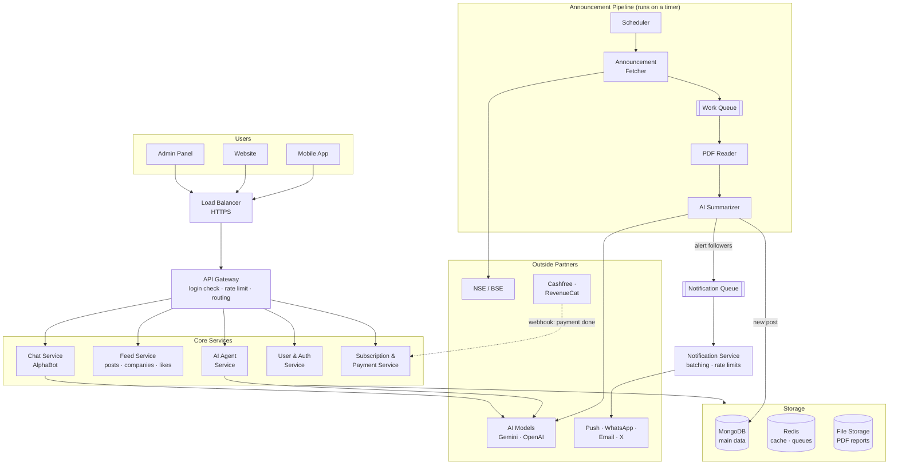
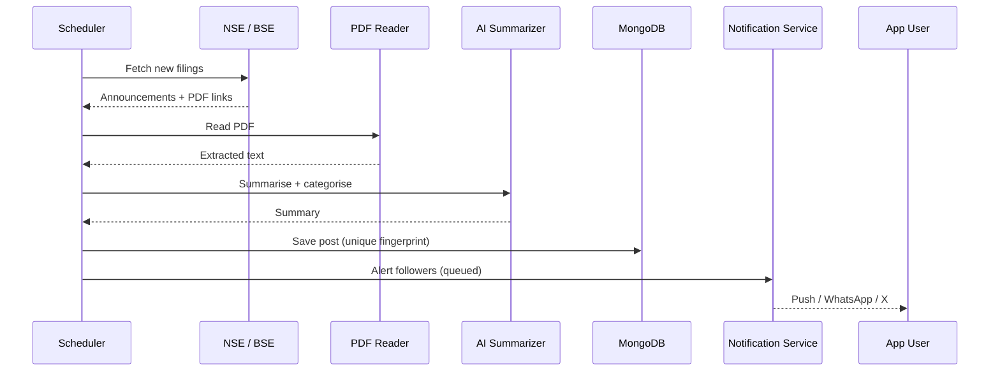

# AlphaTribe — System Design

AlphaTribe reads company announcements from the NSE and BSE stock exchanges, uses AI to turn them into short posts, and shows them to investors in a social feed. Paid users also get AI market reports, an AI chatbot, and WhatsApp alerts.

---

## 1. Functional Requirements

- **Login** – Google, email, or mobile number with WhatsApp OTP.
- **Announcement feed** – Every NSE/BSE filing becomes a short AI summary with a category (results, dividend, insider trading, pledge…) and a link to the original PDF.
- **Social actions** – Like, dislike, comment, follow companies, trending posts.
- **Personalised feed** – "All" and "Following" tabs. Following is a paid feature.
- **Alerts** – When a followed company posts, send push notification, WhatsApp message (WhatsApp plan), and a tweet.
- **AI agents** – Daily NIFTY / Bank Nifty reports plus volume-spike, breakout, golden/death crossover, and pullback agents. Users follow agents and receive PDF reports.
- **AI chatbot (AlphaBot)** – Answers market questions, searches the web, remembers the conversation.
- **Subscriptions** – App plan and WhatsApp plan, paid via Cashfree (web) or RevenueCat (App Store / Play Store).
- **Admin panel** – Manage posts, companies, users, subscriptions, WhatsApp inbox, agent data uploads, statistics, and costs.

## 2. Non-Functional Requirements

- **Freshness** – An announcement reaches the feed within **5 minutes** of the exchange publishing it.
- **Low latency** – Feed loads in **< 300 ms** (served from cache).
- **High availability** – **99.9%** uptime during market hours (9:00–15:30 IST).
- **Correct payments** – A payment is never lost or counted twice.
- **Scalability** – Handles the market-open surge and big result days.
- **Cost control** – Every AI call is tracked; only meaningful documents are summarised.
- **Security** – HTTPS everywhere, login tokens, admin-only areas, secrets kept outside code.

## 3. Key Challenges

### 3.1 Alert storms

A popular company may have 50K followers who must all be alerted.
**Solution:** Alerts go into a **Notification Queue**. Push notifications are sent in **batches of 500 devices per call** (the FCM multicast limit). WhatsApp and email workers slow themselves down to stay within each provider's rate limit (token bucket).

### 3.2 Duplicate announcements

The same filing can appear on NSE and BSE, or a timer job may run twice.
**Solution:** Every post gets a **unique fingerprint** (exchange + filing ID or PDF link). The database rejects a second copy.

### 3.3 AI cost and failures

AI calls are slow, cost money, and sometimes fail.
**Solution:** Retry with growing wait times (exponential backoff), fall back to a second model (Gemini → OpenAI), skip empty or scanned PDFs, and log the cost of every call.

### 3.4 Payment webhooks

Payment providers may send the same "payment successful" message twice or out of order.
**Solution:** Verify the provider's signature and process each `orderId` **only once** (idempotency).

### 3.5 Market-open traffic spike

**Solution:** Serve the feed from the **Redis cache** and add more servers behind the **load balancer** when traffic rises.

## 4. Capacity Estimation

Working assumptions — replace with real analytics.

| Item                            | Estimate                                                                             |
| ------------------------------- | ------------------------------------------------------------------------------------ |
| Registered / daily active users | 100K / 10K                                                                           |
| Announcements per day           | ~5,000 (NSE + BSE) → 5,000 PDF reads + AI summaries                                  |
| Feed requests                   | 10K users × 30 = 300K/day ≈ 4/sec average, **~50/sec peak** at market open           |
| Alerts                          | Up to 50K pushes for one popular post = 100 FCM batches                              |
| Chat messages                   | ~10K/day                                                                             |
| Storage growth                  | Posts 5K × 5 KB ≈ 25 MB/day (~9 GB/year); chats ≈ 20 MB/day; reports in file storage |

## 5. High-Level Architecture



### 5.1 Flow — A new announcement reaches users

1. The **Scheduler** wakes the **Fetcher** at fixed intervals (NSE 5 min, BSE 7 min, insider trades 31 min, pledges 183 min).
2. The **Fetcher** reads exchange feeds, skips filings already seen, and puts each new one on the **Work Queue**.
3. The **PDF Reader** extracts the text; the **AI Summarizer** writes a short summary and picks a category.
4. The post is saved to **MongoDB**, and an "alert followers" job goes onto the **Notification Queue**.
5. The **Notification Service** sends push notifications in batches of 500 and WhatsApp messages at the allowed rate, recording sent / failed for each.



### 5.2 Flow — A user opens the app

App → **Load Balancer** → **API Gateway** (checks login token) → **Feed Service**. The Feed Service checks the **Redis cache** first and only queries MongoDB on a miss. The cache is cleared when someone likes or comments.

### 5.3 Flow — A user buys a plan

1. The app asks the **Payment Service** to create an order.
2. The user pays on Cashfree or the app store.
3. The provider calls our **webhook** ("payment done").
4. The Payment Service verifies the signature, ignores repeats, and activates the subscription.

## 6. Core Components

| Component                  | What it does (plain English)                                                  | Implemented in                                  |
| -------------------------- | ----------------------------------------------------------------------------- | ----------------------------------------------- |
| **Load Balancer**          | Single front door; HTTPS; spreads traffic across servers                      | Nginx                                           |
| **API Gateway**            | Checks identity, blocks abuse, routes requests                                | Middleware inside `at_backend`                  |
| **User & Auth Service**    | Sign-up, login, OTP, sessions                                                 | `at_backend` (users)                            |
| **Feed Service**           | Posts, companies, likes, comments, follows, trending                          | `at_backend` (posts, companies)                 |
| **AI Agent Service**       | Turns market data into daily AI reports (PDF)                                 | `at_agent_backend1.0`                           |
| **Chat Service**           | AlphaBot assistant                                                            | `ChatBot`                                       |
| **Subscription & Payment** | Plans, orders, webhooks, access control                                       | `at_backend` (Cashfree, RevenueCat)             |
| **Announcement Pipeline**  | Fetch → read PDF → summarise → save                                           | `post-genration-backend` + `at_pdf-parser`      |
| **Notification Service**   | One place for push / WhatsApp / email / X with batching, retries, rate limits | `post-genration-backend` (notification workers) |
| **Website**                | Public site: landing, feed, company pages, AI chat                            | `at_webfe` (Next.js, Vercel)                    |
| **Admin Panel**            | Internal tool for the team                                                    | `at_webadmin` (Next.js, Vercel)                 |

## 7. Database Design

### 7.1 MongoDB (main database)

```
users         { _id, name, email, mobileNumber, deviceToken,
                following: [companyId], followingAgents: [agentId] }

companies     { _id, name, ticker, industry, logo, followerCount }

posts         { _id, companyId, title, summary, category, pdfUrl,
                fingerprint (UNIQUE), likes, dislikes, commentsCount, date }

comments      { _id, postId, userId, text, createdAt }

subscriptions { _id, userId, product: 'app' | 'whatsapp', tier,
                platform: 'cashfree' | 'appstore' | 'playstore',
                status, purchasedOn, validTill }

payments      { _id, orderId (UNIQUE), userId, amount, status,
                provider, rawWebhook, createdAt }

agents        { _id, name, type, description, followers }
agentReports  { _id, agentId, date, shortSummary, pdfUrl }

notifications { _id, userId, postId, channel: 'push' | 'whatsapp' | 'email',
                status: 'queued' | 'sent' | 'failed', retries, createdAt }   // auto-delete after 7 days
```

### 7.2 Other stores

- **Market-data DB** – Daily and 15-minute candles with indicators (RSI, MACD, EMA…) per index.
- **Logs DB** – Request and button-click logs.
- **Chat DB** – AlphaBot conversation sessions.
- **Redis** – Feed cache, sessions, the two queues, rate-limit counters (expiry times in 7.3).
- **File Storage (Firebase)** – Generated PDF/DOCX reports and images.

### 7.3 Redis cache expiry (TTL)

Each entry expires on its own and is also cleared early when the underlying data changes (new post, like, follow, admin edit).

| Cached item                            | TTL                                             | Why                                                                |
| -------------------------------------- | ----------------------------------------------- | ------------------------------------------------------------------ |
| Feed pages (All / Following / company) | **60 s** in market hours, **5 min** after hours | New announcements arrive every few minutes                         |
| Trending posts, post details           | **5 min**                                       | Changes slowly; likes clear it early                               |
| Intraday market data and indicators    | **15 min**                                      | Matches the 15-minute candle interval                              |
| Daily market data and agent reports    | **Until next market open (09:00 IST)**          | Generated once per trading day                                     |
| Agent list and details                 | **1 hour**                                      | Rarely changes                                                     |
| Company profiles and lists             | **24 hours**                                    | Rarely changes; admin edits clear it                               |
| User's followed companies / agents     | **10 min**                                      | Follow / unfollow clears it                                        |
| Login sessions                         | **Same as login token expiry**                  | Session must not outlive the token                                 |
| WhatsApp OTP                           | **5 min**                                       | Short-lived by design                                              |
| Rate-limit counters                    | **1 min**                                       | Per-minute limit window                                            |
| "Already seen" filing fingerprints     | **48 hours**                                    | Fast duplicate check; the database unique index is the final guard |
| Queue jobs                             | Completed: **24 hours**, failed: **7 days**     | Enough time to debug failures                                      |

## 8. API Design (examples)

```
POST /v1/auth/login                              → { token }
GET  /v1/feed?tab=all&page=1                     → { posts: [...] }
POST /v1/posts/{id}/like
POST /v1/companies/{id}/follow
POST /v1/chat            { sessionId, message }  → { reply }
POST /v1/payments/order  { plan: "app_monthly" } → { orderId, paymentLink }

POST /webhooks/cashfree      (signature verified, idempotent by orderId)
POST /webhooks/revenuecat
```

## 9. Scalability Measures

- **Horizontal scaling** – Several copies of each service behind the load balancer.
- **Caching** – Feed served from Redis; entries expire per the TTLs in 7.3 or are cleared on change.
- **Queues absorb spikes** – Slow PDF reads or alert bursts wait in a queue instead of crashing the app.
- **Batching** – 500 devices per FCM call; WhatsApp sent at a controlled rate.
- **Auto-scale workers** – Add pipeline / notification workers when a queue grows.
- **Single scheduler** – Only one instance runs timers, so jobs are not missed or doubled.

## 10. Security

- HTTPS end to end; JWT login tokens on every protected request.
- Admin panel has its own login; admin → backend calls use a server-side secret that never reaches the browser.
- Payment webhooks accepted only with a valid provider signature.
- Secrets stored in a secrets manager or environment variables — **never in code or the repository**.
- Rate limits at the gateway; phone numbers and emails masked in logs.

## 11. Monitoring

- Track: queue length, time from exchange to feed, AI cost per day, alert success rate, payment webhook failures, feed latency.
- Alert if no new posts arrive for 30 minutes during market hours.

## 12. Trade-offs & Alternatives

| Choice                           | Why                                                                 | Alternative                                                                   |
| -------------------------------- | ------------------------------------------------------------------- | ----------------------------------------------------------------------------- |
| **MongoDB**                      | Posts and agent reports vary in shape; data already lives there     | PostgreSQL is stronger for payment records; consider if billing grows         |
| **Redis-based queue (BullMQ)**   | Redis already exists; ~5K announcements/day is small                | Kafka offers higher throughput and replay but more cost than this scale needs |
| **Separate services**            | AI work is slow, the feed is fast; isolating them protects the feed | A single app is simpler, but slow AI jobs would slow the feed                 |
| **Polling exchanges on a timer** | NSE/BSE publish feeds, not push events                              | —                                                                             |
| **Cache-first feed**             | Market-open spike, read-heavy traffic                               | Seconds of staleness, accepted                                                |
