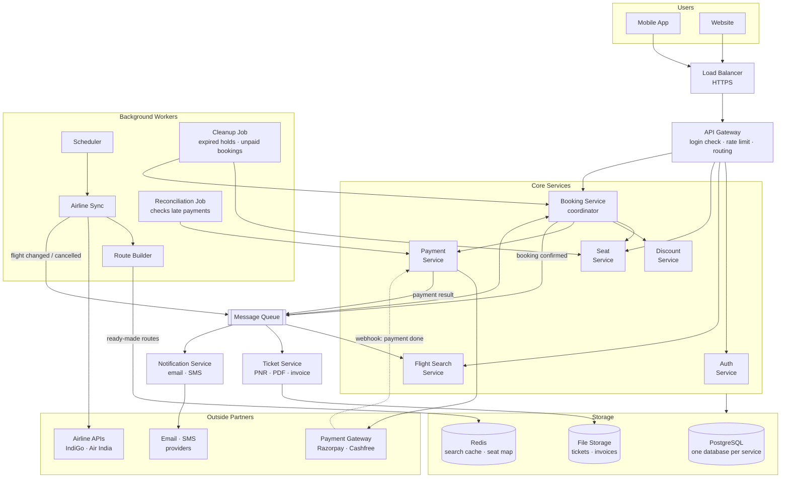
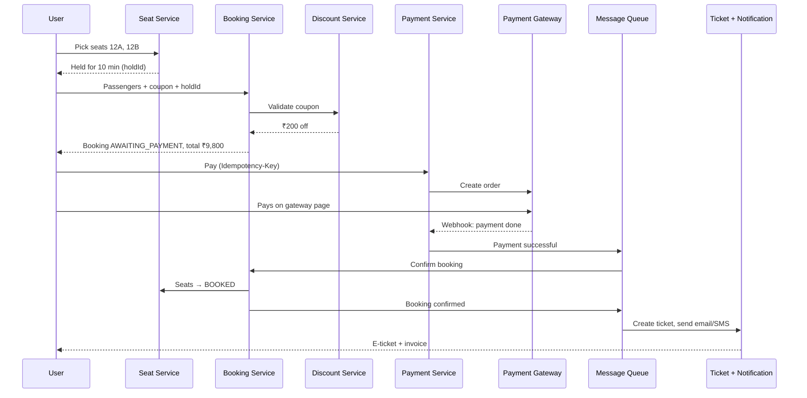
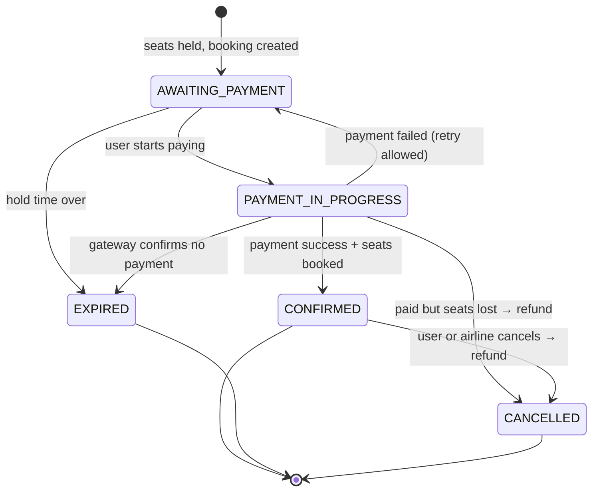

# Flight Booking System (MakeMyTrip-style) — System Design

Users search for domestic flights in India (direct or with one stop), pick seats, apply a discount, pay, and receive an e-ticket and invoice by email/SMS. Flight data comes from airline partners such as IndiGo and Air India.

---

## 1. Functional Requirements

- **Login** – Sign up and log in with email and password; receive a login token.
- **Flight search** – Search by source, destination, and date. Show direct flights and flights with **at most one stop (2 hops)**. India only.
- **Airline data sync** – Pull flights, timings, fares, and seat counts from airline partner APIs.
- **Seat selection** – A user can pick **multiple seats at once**. Picked seats are **held for 10 minutes** so nobody else can take them while the user pays.
- **Passenger details** – Name, age, and email for every seat.
- **Discounts** – Apply coupon codes and card offers **before** paying.
- **Payment** – Pay through a payment gateway (Razorpay / Cashfree). Failed payments release the seats; refunds are supported.
- **Ticket and invoice** – Generate a PNR (booking reference), an e-ticket PDF, and an invoice after successful payment.
- **Notifications** – Email/SMS for booking confirmed, payment failed, and flight cancelled.
- **Booking history** – Users see their past and upcoming bookings.

## 2. Non-Functional Requirements

- **No double booking** – Two people can never get the same seat.
- **Correct payments** – A payment is never lost or charged twice.
- **Low latency** – Search results in **< 300 ms** (served from cache); seat hold in **< 100 ms**.
- **High availability** – **99.9%** uptime; search keeps working even if payments are down.
- **Scalability** – Handles sale days ("₹999 flash sale") with 10× normal traffic.
- **Consistency** – Seats, bookings, and payments are always exact (**strong consistency**). Search results may be a few seconds old (**eventual consistency**).
- **Security** – HTTPS everywhere, login tokens, card details never touch our servers, secrets kept outside code.

## 3. Key Challenges

### 3.1 Two users pick the same seat at the same moment

A user may pick several seats together (12A, 12B). They must get **all of them or none**.
**Solution:** The **database is the single source of truth** for seats. All requested seats are held in **one database transaction** with one conditional update:

```sql
UPDATE seats
SET status = 'HELD', hold_id = :holdId, held_by_user = :userId,
    hold_expires_at = now() + interval '10 minutes'
WHERE flight_id = :flightId
  AND seat_number = ANY(:seats)
  AND (status = 'AVAILABLE' OR (status = 'HELD' AND hold_expires_at < now()));
```

If the number of updated rows is not equal to the number of seats asked for, the transaction is rolled back and the user sees "seat just taken". Two users can never both win, because the database lets only one of them change a row at a time.

### 3.2 User picks seats but never pays

**Solution:** Every hold has an expiry time stored with the seat.

- **Expired holds count as free immediately** – the query above treats `HELD` seats past `hold_expires_at` as available, so release never depends on a background job running on time.
- A **Cleanup Job** runs every minute to tidy up: it resets expired seats to `AVAILABLE`, marks unpaid bookings `EXPIRED`, and releases their coupons.
- When the user starts paying, the hold is **extended once by 5 minutes** so a slow payment page does not lose the seats.

### 3.3 Booking spans many services

Seat → Booking → Payment → Ticket live in different services. A step can fail or arrive late.
**Solution:** The **Booking Service is the coordinator** (a "saga": a series of steps, each with an undo step). It follows a strict **booking state machine** (5.3) and has a clear undo action for every failure (5.4). Every undo step is safe to run twice.

### 3.4 Payment charged twice or lost

The user may press "Pay" twice; the gateway may send the same webhook twice, late, or out of order.
**Solution:** Duplicates are blocked **by the database itself**, not just by code:

- `idempotency_key` is **UNIQUE** → a repeated "Pay" request returns the same order.
- Only **one active payment per booking** (unique rule on `booking_id` for `CREATED` / `SUCCESS` rows).
- Each webhook's `gateway_event_id` is **UNIQUE** → the same webhook is processed only once.
- Only **one refund per payment** (`payment_id` UNIQUE in `refunds`).

The webhook's signature is verified before anything is saved.

### 3.5 One-stop search is slow if computed on every request

**Solution:** Whenever flight data changes, a **Route Builder** pre-computes all direct and one-stop options for each `(source, destination, date)` and stores them in the **Redis cache**. A connection is valid only if the layover is **45 minutes to 12 hours**.

### 3.6 Cached search shows a flight that is no longer bookable

**Solution:** Cached results are removed early when a flight **departs**, is **cancelled**, or is **sold out**. Live seat availability is always re-checked when the user picks seats.

### 3.7 Airline partner API is slow or down

**Solution:** Sync runs **in the background on a timer**, never inside a user request. Failed calls retry with growing wait times (exponential backoff). Users see the last good data.

### 3.8 Sale-day traffic spike

**Solution:** Serve search from cache, add more servers behind the **load balancer**, and apply **rate limits** at the API Gateway.

### 3.9 Messages lost or delivered twice

A service may crash right after saving data but before sending its message, or the queue may deliver a message twice.
**Solution:** **Outbox pattern** – the data change and the message are saved in the **same database transaction**; a small **Outbox Relay** then sends it to the queue and keeps retrying until it succeeds. Receivers record every message ID they have handled and **ignore repeats**. Details in 5.5.

## 4. Capacity Estimation

Working assumptions — replace with real analytics.

| Item                     | Estimate                                                                                     |
| ------------------------ | -------------------------------------------------------------------------------------------- |
| Domestic flights per day | ~3,500 → **~315K flights** for the next 90 days                                              |
| Seats                    | ~180 per flight → **~57M seat rows** for 90 days                                             |
| Bookings                 | ~100K/day ≈ 1.2/sec average, **~20/sec peak**                                                |
| Searches                 | ~100 searches per booking → 10M/day ≈ 115/sec average, **~1,200/sec peak** (5K on sale days) |
| Booking storage          | 100K × 2 KB ≈ 200 MB/day (~75 GB/year)                                                       |
| Ticket and invoice PDFs  | 100K × 100 KB ≈ 10 GB/day → file storage                                                     |
| Search cache             | ~10K airport pairs × 90 days × 5 KB ≈ **4.5 GB** in Redis                                    |
| Active seat holds        | ~50K at peak — small for PostgreSQL (seat rows already exist; only their status changes)     |

## 5. High-Level Architecture



### 5.1 Flow — A user searches for flights

App → **Load Balancer** → **API Gateway** (checks login token) → **Flight Search Service**. The service reads ready-made direct and one-stop options from the **Redis cache**. Only on a miss does it query the flights database and fill the cache. Search never touches seats or payments, so it stays fast.

### 5.2 Flow — A user books and pays

1. **Pick seats** – The **Seat Service** holds all chosen seats for 10 minutes in one step (all or none) and returns a `holdId`.
2. **Enter passengers and coupon** – The **Booking Service** checks the hold belongs to this user, asks the **Discount Service** to validate and reserve the coupon, and calculates the final price **on the server** (never trusts a price sent by the app). Booking is saved as `AWAITING_PAYMENT`.
3. **Pay** – The **Payment Service** creates an order with the payment gateway (same `Idempotency-Key` → same order). The booking moves to `PAYMENT_IN_PROGRESS` and the hold is extended by 5 minutes; the user pays on the gateway's page.
4. **Webhook** – The gateway calls our webhook. The Payment Service verifies the signature, ignores repeats, and saves the payment together with a "payment successful" message (outbox), which is then sent to the **Message Queue**.
5. **Confirm** – The **Booking Service** turns the held seats into `BOOKED` (only if the hold is still theirs), marks the booking `CONFIRMED` and the coupon `USED`, then sends "booking confirmed".
6. **Ticket and alert** – The **Ticket Service** creates the PNR, e-ticket PDF, and invoice; the **Notification Service** emails/SMSes them to the user.



### 5.3 Booking state machine

A booking can only move along the arrows below. Any other move is rejected.



Rules:

- **Every move is a conditional update**: `UPDATE bookings SET status = 'CONFIRMED' WHERE id = :id AND status = 'PAYMENT_IN_PROGRESS'`. If 0 rows change, the move was already made or is not allowed, and the message is safely ignored. This also makes **out-of-order messages harmless** — a late "payment failed" cannot undo a `CONFIRMED` booking.
- Every move is written to `booking_status_history` (from, to, reason, when), giving support a full timeline.
- Refund progress is tracked on the payment (`REFUND_PENDING` → `REFUNDED`), not as a booking state.

### 5.4 Flow — When something fails or is late (compensation)

| What went wrong                       | What the system does                                                                                                                    |
| ------------------------------------- | --------------------------------------------------------------------------------------------------------------------------------------- |
| Some chosen seats already taken       | Nothing is held (all or none); user picks again                                                                                         |
| Coupon invalid or used up             | Booking is not created; user sees the reason                                                                                            |
| Payment failed                        | Booking returns to `AWAITING_PAYMENT`; user may retry until the hold ends                                                               |
| User never pays                       | Cleanup Job: booking `EXPIRED`, seats `AVAILABLE`, coupon released                                                                      |
| Webhook late or missing               | **Reconciliation Job** asks the gateway every 2 min about payments in progress for over 5 min, then continues as if the webhook arrived |
| Paid, but hold expired and seat taken | Booking `CANCELLED`, automatic **refund**, user notified                                                                                |
| Paid after booking already `EXPIRED`  | Automatic **refund**, user notified                                                                                                     |
| Seat Service down during confirm      | Message stays in the queue and is retried; confirming is safe to repeat                                                                 |
| Ticket or PDF creation fails          | Retried; booking stays `CONFIRMED`; after 5 tries → dead-letter queue + alert                                                           |
| Refund call fails                     | Retried with growing waits; after 5 tries → manual review queue for the support team                                                    |
| Email / SMS fails                     | Retried; never affects the booking                                                                                                      |

Every undo step checks the current state first, so running it twice changes nothing.

### 5.5 Flow — Reliable messages between services

1. **Save together** – When a service changes data, it writes the message into its own `outbox` table **in the same transaction**. Either both are saved or neither.
2. **Send** – The **Outbox Relay** reads unsent rows, publishes them to the **Message Queue**, and marks them sent. If the queue is down, it keeps retrying; nothing is lost.
3. **Receive once** – Each receiver saves the message ID in `processed_events` in the same transaction as its work. A repeated message hits the unique ID and is skipped.
4. **Retry, then park** – A failing message is retried with growing waits; after 5 tries it moves to a **dead-letter queue** (a holding area for failed messages) and raises an alert. It can be replayed after the fix.
5. **Carry context** – Every message has `eventId`, `bookingId`, and `traceId`, so it can be followed end to end (section 11).

### 5.6 Flow — Airline data changes

1. The **Scheduler** wakes **Airline Sync** every few minutes; it fetches new flights, fare changes, and cancellations.
2. Changes are saved to the flights database and announced on the **Message Queue**.
3. The **Route Builder** rebuilds affected direct / one-stop options in the cache; the **Search Service** clears stale entries.
4. On a **cancellation**, the Booking Service finds affected bookings, triggers refunds, and the Notification Service informs the passengers.

## 6. Core Components

| Component                        | What it does (plain English)                                                     | Implemented in                                    |
| -------------------------------- | -------------------------------------------------------------------------------- | ------------------------------------------------- |
| **Load Balancer**                | Single front door; HTTPS; spreads traffic across servers                         | Nginx (to add)                                    |
| **API Gateway**                  | Checks login token once, blocks abuse, routes requests to the right service      | `api-gateway`                                     |
| **Auth Service**                 | Sign-up, login, password hashing, login tokens                                   | `auth-service`                                    |
| **Flight Search Service**        | Direct and one-stop search, served from cache                                    | `flight-search-service`                           |
| **Airline Sync + Route Builder** | Pulls airline data on a timer; pre-computes one-stop routes                      | `flight-search-service` (seed + `Graph.ts` today) |
| **Seat Service**                 | Seat map, 10-minute holds, final seat booking                                    | `seat-service`                                    |
| **Booking Service**              | Passenger details, server-side price, booking status, coordinates the whole flow | `booking-service`                                 |
| **Discount Service**             | Validates coupons, usage limits, expiry                                          | `discount-service`                                |
| **Payment Service**              | Talks to the payment gateway, webhooks, refunds, payment records                 | `payment-service`                                 |
| **Ticket Service**               | PNR, e-ticket PDF, invoice                                                       | `ticket-service`                                  |
| **Notification Service**         | Email / SMS with retries and provider rate limits                                | `notification-service`                            |
| **Message Queue**                | Carries "payment done", "booking confirmed", "flight cancelled" between services | RabbitMQ (to add)                                 |
| **Cleanup Job**                  | Releases expired seat holds and unpaid bookings every minute                     | `seat-service` / `booking-service` (to add)       |
| **Reconciliation Job**           | Asks the gateway about payments with no webhook yet and settles them             | `payment-service` (to add)                        |
| **Outbox Relay**                 | Sends saved messages from each service's `outbox` table to the queue             | `booking-service` / `payment-service` (to add)    |

## 7. Database Design

Each service owns **its own PostgreSQL database**. Services never read another service's database — they ask the service through its API or listen on the queue.

### 7.1 PostgreSQL tables

```
-- Auth Service
users          ( id, name, email UNIQUE, password_hash, created_at )

-- Flight Search Service
flights        ( id, flight_number, airline, source, destination,
                 departure_time, arrival_time, base_fare,
                 status: 'SCHEDULED' | 'CANCELLED' | 'DEPARTED',
                 UNIQUE(flight_number, departure_time) )

-- Seat Service
seats          ( flight_id, seat_number, class,
                 status: 'AVAILABLE' | 'HELD' | 'BOOKED',
                 hold_id, held_by_user, hold_expires_at, booking_id,
                 PRIMARY KEY(flight_id, seat_number) )
                 -- index on (status, hold_expires_at) for the Cleanup Job

-- Booking Service
bookings       ( id, pnr UNIQUE, user_id, flight_id, hold_id UNIQUE,
                 fare, discount, total, coupon_code,
                 status: 'AWAITING_PAYMENT' | 'PAYMENT_IN_PROGRESS' |
                         'CONFIRMED' | 'EXPIRED' | 'CANCELLED',
                 expires_at, created_at, updated_at )
passengers     ( booking_id, seat_number, name, age, email )
booking_status_history ( booking_id, from_status, to_status, reason,
                 event_id, changed_at )

-- Discount Service
coupons        ( code PRIMARY KEY, type: 'FLAT' | 'PERCENT', value, max_discount,
                 valid_from, valid_till, per_user_limit, total_limit )
coupon_usage   ( code, user_id, booking_id UNIQUE,
                 status: 'RESERVED' | 'USED' | 'RELEASED' )

-- Payment Service
payments       ( id, booking_id, idempotency_key UNIQUE,
                 gateway_order_id UNIQUE, gateway_payment_id UNIQUE, amount,
                 status: 'CREATED' | 'SUCCESS' | 'FAILED' | 'REFUND_PENDING' | 'REFUNDED',
                 created_at, updated_at )
                 -- UNIQUE(booking_id) WHERE status IN ('CREATED','SUCCESS')
                 --   → only one active payment per booking
payment_webhook_events ( gateway_event_id PRIMARY KEY, payment_id, type,
                 raw_body, received_at )          -- each webhook handled once
refunds        ( id, payment_id UNIQUE, amount,
                 status: 'PENDING' | 'DONE' | 'FAILED', attempts, created_at )

-- Ticket Service
tickets        ( id, booking_id UNIQUE, pnr, user_id, ticket_pdf_url,
                 invoice_pdf_url, issued_at )

-- In every service that sends or receives messages
outbox           ( id, event_type, booking_id, payload, trace_id,
                   created_at, sent_at NULL )
processed_events ( event_id PRIMARY KEY, processed_at )
```

### 7.2 Other stores

- **Redis** – Search cache, seat map cache, rate-limit counters (expiry times in 7.3). Seat holds and payment idempotency live in **PostgreSQL**, not Redis, so they survive a Redis restart.
- **File Storage (S3 / GCS)** – E-ticket and invoice PDFs, shared with users via short-lived download links.

### 7.3 Redis cache expiry (TTL)

Each entry expires on its own and is also cleared early when the underlying data changes.

| Cached item                                | TTL                            | Why                                                             |
| ------------------------------------------ | ------------------------------ | --------------------------------------------------------------- |
| Search results `search:{src}:{dst}:{date}` | **10 min**                     | Fares change often; cleared early on cancel / depart / sold out |
| Seat map of a flight                       | **30 s**                       | Seats change quickly; cleared on every hold or booking          |
| Airport and airline lists                  | **24 hours**                   | Rarely changes                                                  |
| Coupon details                             | **5 min**                      | Admin edits clear it early                                      |
| Rate-limit counters                        | **1 min**                      | Per-minute limit window                                         |
| Login session / token blocklist            | **Same as login token expiry** | Must not outlive the token                                      |

## 8. API Design (examples)

```
POST   /v1/auth/signup | /v1/auth/login                  → { token }
GET    /v1/flights/search?from=DEL&to=BLR&date=2026-12-01 → { options: [direct, one-stop...] }
GET    /v1/flights/{id}/seats                            → { seats: [...] }
POST   /v1/seats/hold     { flightId, seats: ["12A","12B"] } → { holdId, expiresAt }
POST   /v1/discounts/validate { holdId, code }           → { discount }
POST   /v1/bookings       { holdId, passengers, couponCode } → { bookingId, total, status }
GET    /v1/bookings/{id}
POST   /v1/payments       { bookingId }  + Idempotency-Key header → { paymentLink }
GET    /v1/tickets/{bookingId}                           → { pnr, ticketUrl, invoiceUrl }

POST   /webhooks/payment-gateway   (signature verified, processed once per payment)
```

The **user ID always comes from the login token**, never from the request body or URL.

## 9. Scalability Measures

- **Horizontal scaling** – Several copies of each service behind the load balancer. Search scales separately from booking.
- **Caching** – Search served from Redis; entries expire per the TTLs in 7.3 or are cleared on change.
- **Read copies** – The flights database has read replicas for search; writes go to the main copy.
- **Queues absorb spikes** – Ticket PDFs and emails wait in the queue instead of slowing the booking response.
- **Split large tables** – Seats and flights are split by travel date (partitioning), so old dates are cheap to archive.
- **Rate limits and waiting room** – On sale days, the gateway limits requests per user, and seat holding can use a short waiting queue.
- **Fail safely** – Timeouts and retries on every call to airlines and the payment gateway; if the gateway is down, search and browsing keep working.

## 10. Security

- HTTPS end to end; login tokens (JWT) expire in 15 minutes and are refreshed.
- One shared way of signing tokens across all services (today each service has a different default secret).
- Every request checks that the booking, ticket, or payment **belongs to the logged-in user**.
- Prices and discounts are calculated only on the server.
- Card details are entered on the payment gateway's page — they never reach our servers.
- Payment webhooks accepted only with a valid gateway signature.
- Secrets stored in a secrets manager — **never in code or the repository** (the `.env` files in this repo are for local testing only).
- Rate limits on login to stop password guessing; emails and phone numbers masked in logs.

## 11. Observability (whole booking journey)

- **One ID through the whole journey** – The gateway creates a `traceId`; every service call, log line, and queue message carries it along with the `bookingId`. Tracing (OpenTelemetry → Jaeger / Tempo) shows one booking from search to email as a single timeline.
- **Structured logs** – JSON logs with `traceId`, `bookingId`, `userId`; emails and phone numbers masked.
- **Booking funnel dashboard** – search → hold → booking → payment started → paid → confirmed → ticket sent, showing drop-off and time spent at each step.
- **Key metrics** (Prometheus + Grafana) – search latency and cache hit rate; seat hold conflicts and expiries; payment success rate and webhook delay; refunds pending; queue length, oldest message age, dead-letter count; unsent outbox rows and their age; airline sync failures.
- **"Stuck booking" alerts**:
  - `PAYMENT_IN_PROGRESS` for more than 15 minutes
  - Payment `SUCCESS` but booking not `CONFIRMED` after 2 minutes
  - `CONFIRMED` without a ticket after 5 minutes
  - Refund pending for more than 24 hours
  - Any message in the dead-letter queue
- **Support view** – `booking_status_history` and `payment_webhook_events` show exactly what happened to any booking.

## 12. Testing

Unit tests (`npm run test`, `npm run test:all`) check each service alone with mocks. The booking journey also needs **integration tests** that run the real services, PostgreSQL, Redis, and RabbitMQ together (Docker Compose or Testcontainers) with a **fake payment gateway** that can succeed, fail, delay, or repeat webhooks.

| Scenario                                                      | Expected result                                               |
| ------------------------------------------------------------- | ------------------------------------------------------------- |
| 50 users hold the same seat at the same time                  | Exactly 1 succeeds; 49 get "seat just taken"                  |
| Two users hold overlapping seats (12A+12B vs 12B+12C) at once | One gets both seats, the other gets none                      |
| Hold expires, then another user holds the seat                | Second user succeeds; first user's late payment is refunded   |
| "Pay" sent twice with the same key                            | One gateway order, one payment row                            |
| Same success webhook sent 3 times                             | One payment, one ticket, one email                            |
| "Failed" webhook arrives after "success"                      | Booking stays `CONFIRMED`                                     |
| Payment fails, user never retries                             | After expiry: booking `EXPIRED`, seats and coupon released    |
| Webhook never arrives                                         | Reconciliation Job settles the payment                        |
| Service crashes after saving, before sending the message      | Outbox Relay still delivers the message                       |
| Ticket Service down for 5 minutes                             | Messages wait; tickets created after restart, none duplicated |
| Coupon with 1 use left applied by two users at once           | Only one booking gets the discount                            |

Tests check the final database state (seats, bookings, payments, outbox), not just API responses.

## 13. Trade-offs & Alternatives

| Choice                                    | Why                                                                          | Alternative                                                                          |
| ----------------------------------------- | ---------------------------------------------------------------------------- | ------------------------------------------------------------------------------------ |
| **PostgreSQL**                            | Seats and money need exact, all-or-nothing updates                           | NoSQL scales reads easily but makes "no double booking" harder                       |
| **Seat holds in PostgreSQL**              | One source of truth; exact expiry; ~20 bookings/sec is easy for the database | Redis locks are faster but can disagree with the database after a crash              |
| **Outbox pattern**                        | No lost messages without a cross-service transaction                         | Sending the message right after saving can lose it if the service crashes in between |
| **Deliver at least once + skip repeats**  | Simple and reliable with any queue                                           | "Exactly once" delivery is complex and tied to specific queue products               |
| **Pre-computed one-stop routes**          | Search stays fast regardless of traffic                                      | Calculating routes on every search is simpler but slower at scale                    |
| **Booking Service as coordinator (saga)** | Clear undo steps when payment fails                                          | A single big transaction cannot span separate services and the gateway               |
| **RabbitMQ**                              | Reliable, simple, enough for ~100K bookings/day                              | Kafka offers replay and higher throughput but more cost than needed now              |
| **Webhook for payment result**            | The gateway is the source of truth; works even if the user closes the app    | Trusting the app's "payment done" message is unsafe                                  |
| **Cache-first search**                    | Read-heavy traffic and sale-day spikes                                       | Results may be a few minutes old; accepted because seats are re-checked at hold time |

